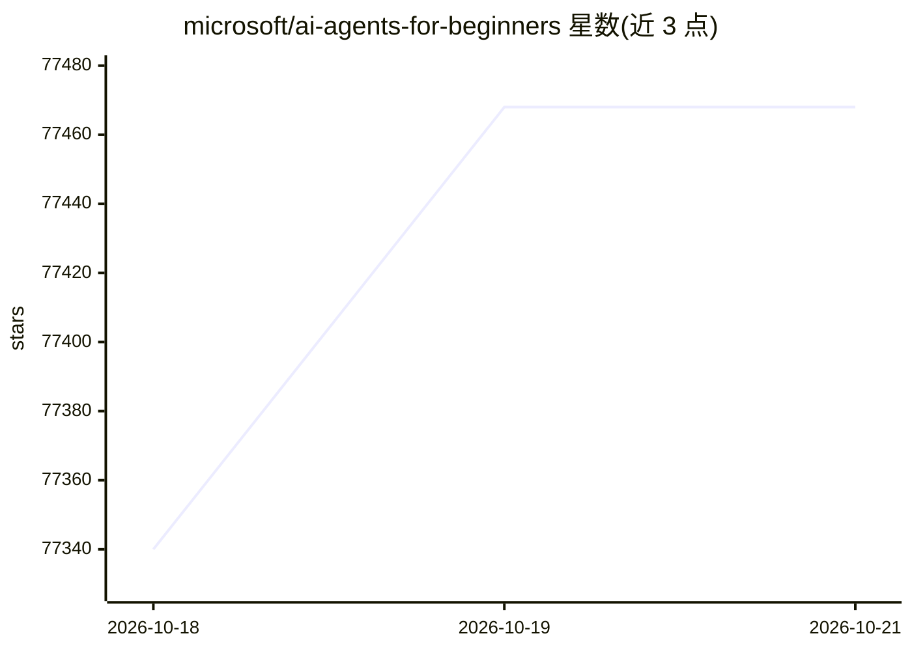

# microsoft/ai-agents-for-beginners

⭐ 77,468 · Jupyter Notebook · MIT · 推送 2026-10-18 · [GitHub](https://github.com/microsoft/ai-agents-for-beginners) · [官网](https://aka.ms/ai-agents-beginners) · 组织维护

**面向初学者的 AI Agent 构建 18 课教程课程**

微软官方出品的 AI Agent 教学课程，共 18 课，内容覆盖 Agent 基础概念、设计模式（工具使用、规划、多智能体、元认知）、Agentic RAG、MCP/A2A 协议、上下文工程、记忆管理、生产部署与安全等。每课含文字教材、短视频、Python 代码示例与扩展资源。代码示例使用 Microsoft Agent Framework 与 Microsoft Foundry Agent Service V2，需要 Azure 账户；部分示例兼容 OpenAI 兼容服务商（如 MiniMax）。

## 筛选速览

| 维度 | 判定 | 备注 |
|---|---|---|
| AI 角色 | `ai-knowledge` | 知识聚合/清单类 |
| 许可风险 | `permissive` | MIT |
| 部署形态 | `None` |  |
| 模型依赖 | — | README 未给出锁定关系 |
| 硬件要求 | — | 无带数字的原话,不猜 |
| 安装摩擦 | `low` | 无编译、无系统依赖或容器化 |
| 成熟度 | — | 结构信号不足 |

## 动量与使用信号

- 维护:`active` — 距上次 push 0.8 天,年发版 0,110 位贡献者
- 涨星:近 1 天 **+83**(自 20261016 起算)
- 平台:WINDOWS / MACOS / LINUX · 协议:OPENAI-API / MCP

## 能力要点

- 18 节课程，每课含文字教材、视频、Python 代码示例
- 覆盖设计模式、Agentic RAG、MCP/A2A 协议、记忆与安全等主题
- 代码示例基于 Microsoft Agent Framework 与 Foundry Agent Service V2
- 提供 50+ 语言翻译版本，支持 sparse checkout 加速克隆

## 适用场景

- 系统学习构建 AI Agent 的基础与设计模式
- 按课程代码示例动手实践 Agent 框架用法
- 了解 MCP、A2A 等协议与生产部署知识

## 场景标签

`教程课程` · 领域:学习与行业

## 证据(README 行号)

> L5: ## A course teaching everything you need to know to start building AI Agents
> L69: This course uses the following AI Agent frameworks and services from Microsoft:
> L71: - Microsoft Agent Framework (MAF)

## 星数曲线

2026-10-18 77,340 → 2026-10-21 77,468（+128）

---
*卡片 v1 · prompt 1.4 · 生成 2026-10-18 · 置信度 high · 依据 README sha `41998c062eac` · [字段定义](../../DATASET.md)*
