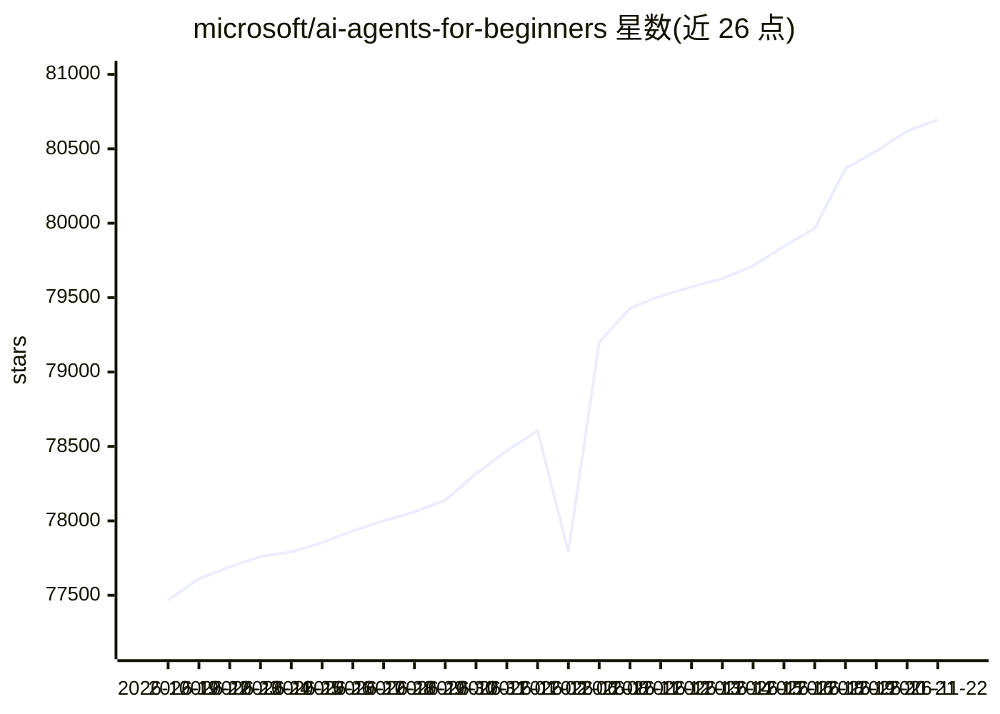

# microsoft/ai-agents-for-beginners

⭐ 80,694 · Jupyter Notebook · MIT · 推送 2026-11-17 · [GitHub](https://github.com/microsoft/ai-agents-for-beginners) · [官网](https://aka.ms/ai-agents-beginners) · 组织维护

**面向初学者的 AI Agent 构建18课教程课程**

Microsoft 出品的课程仓库，共 18 课，每课包含文字讲义、短视频、Python 代码示例与延伸资源。课程覆盖 Agent 基础概念、设计模式（工具使用、规划、多智能体、元认知、Agentic RAG）、生产部署、安全以及 MCP/A2A/NLWeb 等协议。代码示例基于 Microsoft Agent Framework 与 Microsoft Foundry Agent Service V2，部分示例支持 MiniMax 等 OpenAI 兼容提供商。需 Azure 账号，仓库支持多语言翻译并可通过 sparse checkout 只克隆英文内容。

## 筛选速览

| 维度 | 判定 | 备注 |
|---|---|---|
| AI 角色 | `ai-knowledge` | 知识聚合/清单类 |
| 许可风险 | `permissive` | MIT |
| 部署形态 | `None` |  |
| 模型依赖 | — | README 未给出锁定关系 |
| 硬件要求 | — | 无带数字的原话,不猜 |
| 安装摩擦 | `low` | 无编译、无系统依赖或容器化 |
| 成熟度 | — | 结构信号不足 |

## 动量与使用信号

- 维护:`active` — 距上次 push 0.8 天,年发版 0,110 位贡献者
- 涨星:近 1 天 **+83**(自 20261016 起算)
- 平台:WINDOWS / MACOS / LINUX · 协议:OPENAI-API / MCP

## 能力要点

- 18 课覆盖 Agent 设计模式、协议（MCP/A2A/NLWeb）、部署与安全
- 每课含 Python 代码示例、文字讲义与短视频
- 代码基于 Microsoft Agent Framework 与 Foundry Agent Service V2
- 50+ 语言翻译，支持 sparse checkout 减少下载体积

## 适用场景

- 作为初学者系统学习构建 AI Agent 的入门课程
- 参考代码示例学习 Agentic RAG 与多智能体模式
- 按需选择单课自学某一 Agent 主题

## 场景标签

`教程课程` · 领域:学习与行业

## 证据(README 行号)

> L5: ## A course teaching everything you need to know to start building AI Agents
> L49: This course has lessons covering the fundamentals of building AI Agents. Each lesson covers its own topic so start 
> L71: - Microsoft Agent Framework (MAF)

## 星数曲线

2026-10-19 77,468 → 2026-11-22 80,694（+3,226）

---
*卡片 v1 · prompt 1.4 · 生成 2026-11-22 · 置信度 high · 依据 README sha `2f1e58550692` · [字段定义](../../DATASET.md)*
