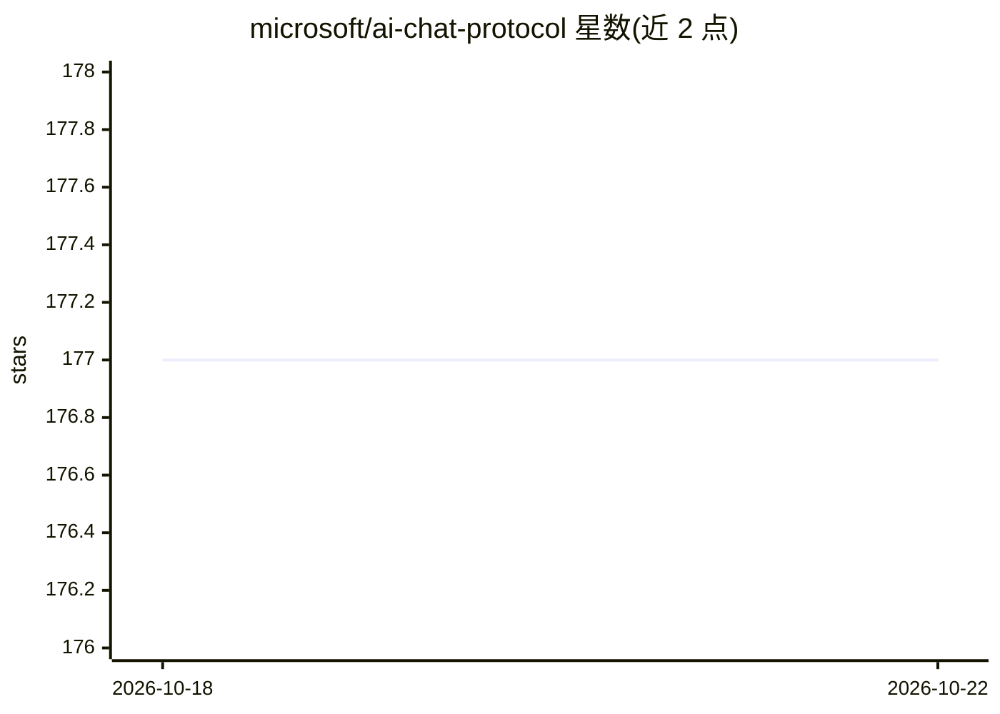

# microsoft/ai-chat-protocol

⭐ 177 · TypeScript · MIT · 推送 2026-10-22 · [GitHub](https://github.com/microsoft/ai-chat-protocol) · 组织维护

**微软的生成式 AI 聊天流式输出 SDK 与 API 规范**

仓库包含一个 NPM 库与配套 API 规范：库用 TypeScript 编写，供开发者按统一 API 契约构建 AI 聊天界面——创建客户端指向聊天端点、以同步或流式方式消费 AI 推理后端与中间层，并可加入 HTTP 中间件做日志与认证。规范使后端消费与评测不依赖具体模型或编排工具即可一致进行。目前处于 public preview，入门指南尚未完成，提供 npm 安装与多个 Azure 示例。

## 筛选速览

| 维度 | 判定 | 备注 |
|---|---|---|
| AI 角色 | `ai-ecosystem` | LLM/agent 周边工具 |
| 许可风险 | `permissive` | MIT |
| 部署形态 | `library` | 以包/库形式分发 |
| 模型依赖 | — | README 未给出锁定关系 |
| 硬件要求 | — | 无带数字的原话,不猜 |
| 安装摩擦 | `low` | 无编译、无系统依赖或容器化 |
| 成熟度 | `idea` | |

## 能力要点

- JavaScript/TypeScript SDK 用于构建 AI 聊天界面
- 标准 API 契约使后端消费与评测跨服务一致
- 支持同步与流式获取补全输出
- 支持叠加 HTTP 中间件（日志、认证等）

## 适用场景

- 前端聊天应用统一对接遵循该规范的 AI 后端
- 对不同模型/编排工具的后端做一致消费与评测
- 为聊天界面添加流式补全输出

## 场景标签

 · 领域:LLM 基础设施/应用开发

## 证据(README 行号)

> L6: The Microsoft AI Chat Protocol SDK is a library for easily building AI Chat interfaces from services that follow the
> L8: By agreeing on a standard API contract, AI backend consumption and evaluation can be performed easily and consistent

## 星数曲线

2026-10-18 177 → 2026-10-22 177（+0）

---
*卡片 v1 · prompt 1.4 · 生成 2026-10-22 · 置信度 high · 依据 README sha `91ce4cf9e603` · [字段定义](../../DATASET.md)*
