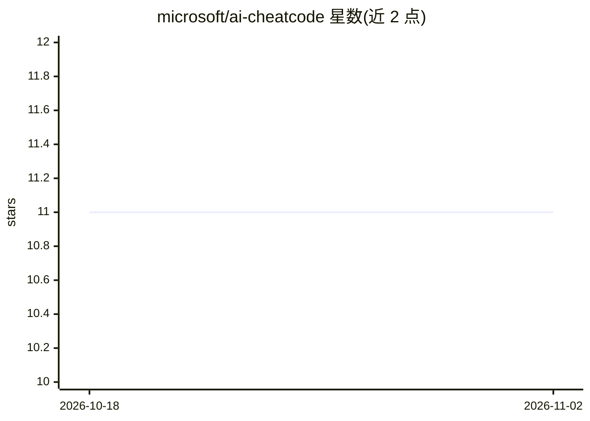

# microsoft/ai-cheatcode

⭐ 11 · HTML · MIT · 推送 2026-06-08 · [GitHub](https://github.com/microsoft/ai-cheatcode) · [官网](https://microsoft.github.io/ai-cheatcode/) · 组织维护

**微软内部周报存档：Copilot Chat 的 Agent 模式合集**

由微软 ABS Tech Strategy 团队维护的内部周报 The Cheat Code 的存档仓库：从真实客户项目中提取可复用的 agentic 模式，每期一个模式，自 #008 起交替发布概念模式（命名与架构框架）与实操构建（Copilot Studio 分步搭建）。已发布 8 期，每期附 Prompt Pack / Starter Kit / Deployable Template 三档配套代码示例，并通过 GitHub Pages 门户提供架构图分步走读。README 声明 Microsoft Internal，不对外分发。

## 筛选速览

| 维度 | 判定 | 备注 |
|---|---|---|
| AI 角色 | `ai-knowledge` | 知识聚合/清单类 |
| 许可风险 | `permissive` | MIT |
| 部署形态 | `None` |  |
| 模型依赖 | — | README 未给出锁定关系 |
| 硬件要求 | — | 无带数字的原话,不猜 |
| 安装摩擦 | `low` | 无编译、无系统依赖或容器化 |
| 成熟度 | — | 结构信号不足 |

## 能力要点

- 已发布 8 期 Agent 模式，来自真实微软客户项目
- 每期配 Prompt Pack / Starter Kit / Deployable Template 代码示例
- GitHub Pages 交互门户提供架构图逐组件走读
- 含完整的期刊发布流程（模板、PDF 渲染、分发渠道）

## 适用场景

- 构建 Copilot Chat/Studio Agent 时查找可复用模式
- 了解企业客户场景中提炼的 Agent 架构方案
- 按模式获取配套提示词包或可部署模板快速上手

## 场景标签

`教程课程` `提示工程` · 领域:Agent 开发

## 证据(README 行号)

> L18: The Cheat Code is a weekly internal newsletter that extracts **reusable agentic patterns** from real Microsoft cust
> L12: *Each issue: one reusable pattern, extracted from a real customer engagement, ready to land.*
> L106: Microsoft Internal — Not for external distribution.

## 星数曲线

2026-10-18 11 → 2026-11-02 11（+0）

---
*卡片 v1 · prompt 1.4 · 生成 2026-11-02 · 置信度 high · 依据 README sha `5897194d4b5b` · [字段定义](../../DATASET.md)*
