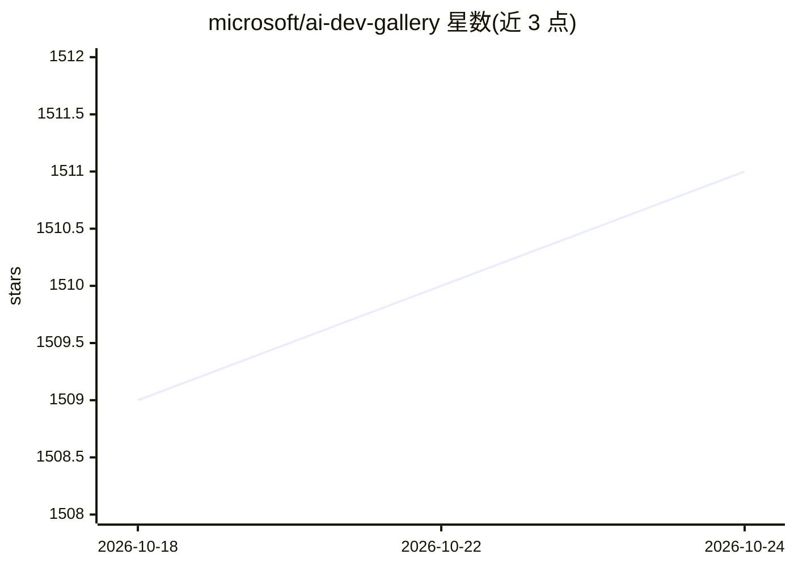

# microsoft/ai-dev-gallery

⭐ 1,511 · C# · MIT · 推送 2026-10-17 · [GitHub](https://github.com/microsoft/ai-dev-gallery) · 组织维护

**面向 Windows 开发者的 AI 集成示例库与本地模型浏览工具**

微软开源的 Windows 桌面应用，供 Windows 开发者学习如何将 AI（本地模型与 API）加入应用：内置 25+ 个交互式 C# 示例，可从 Hugging Face 与 GitHub 浏览、下载并本地运行模型，一键查看源码并导出独立 Visual Studio 工程。示例在应用内运行；下载模型后导出的工程可独立运行。需 Windows 10 1809 及以上，推荐 16GB 内存、20GB 磁盘、8GB VRAM GPU。当前处于公开预览阶段。

## 筛选速览

| 维度 | 判定 | 备注 |
|---|---|---|
| AI 角色 | `ai-ecosystem` | LLM/agent 周边工具 |
| 许可风险 | `permissive` | MIT |
| 部署形态 | `None` |  |
| 模型依赖 | — | README 未给出锁定关系 |
| 硬件要求 | — | 无带数字的原话,不猜 |
| 安装摩擦 | `low` | 无编译、无系统依赖或容器化 |
| 成熟度 | `idea` | |

## 能力要点

- 25+ 个本地模型驱动的交互式示例
- 从 Hugging Face 与 GitHub 浏览、下载并运行模型
- 查看 C# 源码并一键导出独立 Visual Studio 工程
- 模型本地下载后应用可离线运行

## 适用场景

- Windows 应用开发者学习如何在应用中加入本地 AI 模型
- 浏览和下载开源模型并直接试用
- 将示例导出为 Visual Studio 工程作为开发起点

## 场景标签

`教程课程` · 领域:学习与行业

## 证据(README 行号)

> L8: Designed for Windows developers, the AI Dev Gallery helps integrate AI capabilities into apps and projects. It inclu
> L10: - **Explore over 25 interactive samples powered by local AI models**
> L12: - **View the C# source code and export standalone Visual Studio projects with a single click**

## 星数曲线

2026-10-18 1,509 → 2026-10-24 1,511（+2）

---
*卡片 v1 · prompt 1.4 · 生成 2026-10-21 · 置信度 high · 依据 README sha `8fff0a34e109` · [字段定义](../../DATASET.md)*
