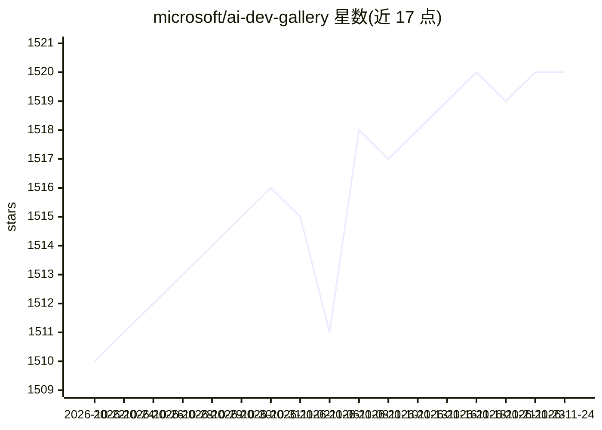

# microsoft/ai-dev-gallery

⭐ 1,520 · C# · MIT · 推送 2026-11-21 · [GitHub](https://github.com/microsoft/ai-dev-gallery) · 组织维护

**给 Windows 开发者学习在应用中集成本地 AI 模型的示例库**

微软面向 Windows 开发者的示例应用（公开预览）：内置 25+ 个基于本地 AI 模型的交互式示例，可浏览并下载 Hugging Face 与 GitHub 上的模型，运行时无需联网；每个示例可查看 C# 源码并一键导出为独立 Visual Studio 项目。运行需 Windows 10 (1809+)，x64/ARM64 架构，推荐 16GB 内存、20GB 磁盘空间、8GB 显存；构建需 Visual Studio 2022。可从 Microsoft Store 安装或源码构建。

## 筛选速览

| 维度 | 判定 | 备注 |
|---|---|---|
| AI 角色 | `ai-ecosystem` | LLM/agent 周边工具 |
| 许可风险 | `permissive` | MIT |
| 部署形态 | `None` |  |
| 模型依赖 | — | README 未给出锁定关系 |
| 硬件要求 | — | 无带数字的原话,不猜 |
| 安装摩擦 | `low` | 无编译、无系统依赖或容器化 |
| 成熟度 | `idea` | |

## 能力要点

- 25+ 个由本地模型驱动的交互式示例
- 浏览、下载并运行 Hugging Face / GitHub 模型，离线可用
- 查看 C# 源码并一键导出独立 Visual Studio 项目
- 模型可选用，支持 GPU 与 NPU 相关场景（DirectML/ONNX Runtime GenAI）

## 适用场景

- 学习在 WinUI 应用中调用本地模型实现 AI 功能
- 挑选合适的本地模型并直接试用效果
- 把示例导出为 VS 项目作为自己应用的开发起点

## 场景标签

`图像生成` `语音识别` `教程课程` · 领域:内容生成

## 证据(README 行号)

> L8: Designed for Windows developers, the AI Dev Gallery helps integrate AI capabilities into apps and projects. It inclu
> L10: - **Explore over 25 interactive samples powered by local AI models**
> L12: - **View the C# source code and export standalone Visual Studio projects with a single click**

## 星数曲线

2026-10-22 1,510 → 2026-11-24 1,520（+10）

---
*卡片 v1 · prompt 1.4 · 生成 2026-11-23 · 置信度 high · 依据 README sha `ed3f3d5edf08` · [字段定义](../../DATASET.md)*
