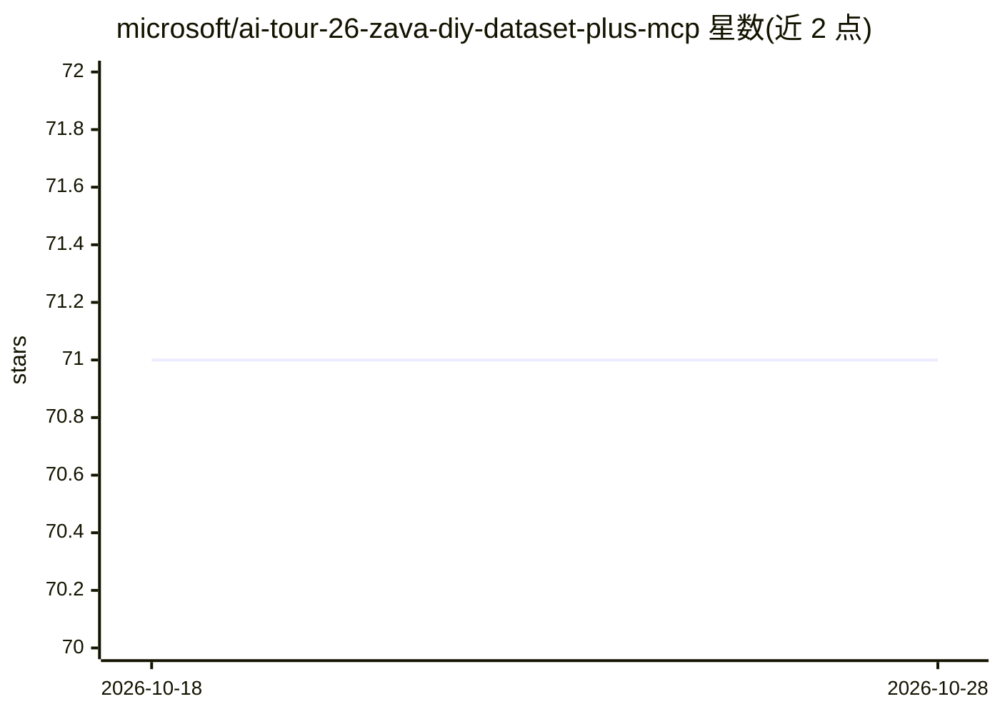

# microsoft/ai-tour-26-zava-diy-dataset-plus-mcp

⭐ 71 · Python · MIT · 推送 2026-01-18 · [GitHub](https://github.com/microsoft/ai-tour-26-zava-diy-dataset-plus-mcp) · 组织维护

**虚构零售公司数据集加三个 MCP 服务器的演示项目**

微软 AI Tour 演示项目：提供虚构家居建材零售商 Zava DIY 的 PostgreSQL/MS SQL 数据集（5 万+客户、400+商品、20 万+订单行、400+ 向量嵌入），并附带三个 MCP 服务器——基础商品搜索、基于 Azure OpenAI text-embedding-3-small 与 pgvector 的语义搜索、以及支持行级安全（RLS）多店数据隔离的销售分析服务器。通过 VS Code Dev Container（Docker）搭建环境，可选脚本部署 Azure AI Foundry 资源。

## 筛选速览

| 维度 | 判定 | 备注 |
|---|---|---|
| AI 角色 | `ai-ecosystem` | LLM/agent 周边工具 |
| 许可风险 | `permissive` | MIT |
| 部署形态 | `None` |  |
| 模型依赖 | — | README 未给出锁定关系 |
| 硬件要求 | — | 无带数字的原话,不猜 |
| 安装摩擦 | `low` | 无编译、无系统依赖或容器化 |
| 成熟度 | — | 结构信号不足 |

## 能力要点

- 5 万+客户、400+商品、20 万+订单行的零售数据集与 pgvector 向量嵌入
- 三个 MCP 服务器：名称搜索、语义搜索、销售分析
- 行级安全（RLS）实现多店数据隔离与门店经理访问控制
- Dev Container 一键搭建，可选 Azure AI Foundry 部署脚本

## 适用场景

- 学习或演示 MCP 服务器与数据库集成的零售分析场景
- 基于真实感数据构建 AI 商品搜索或语义检索应用原型
- 练习多租户行级安全的数据访问模式

## 场景标签

`语义搜索` `数据分析` · 领域:效率与自动化

## 证据(README 行号)

> L10: - **🔍 Customer Sales MCP Servers**: Two intelligent product search servers - basic name-based search and advanced s
> L131: - AI-powered semantic product search using Azure OpenAI

## 星数曲线

2026-10-18 71 → 2026-10-28 71（+0）

---
*卡片 v1 · prompt 1.4 · 生成 2026-10-24 · 置信度 high · 依据 README sha `c975330e9edf` · [字段定义](../../DATASET.md)*
