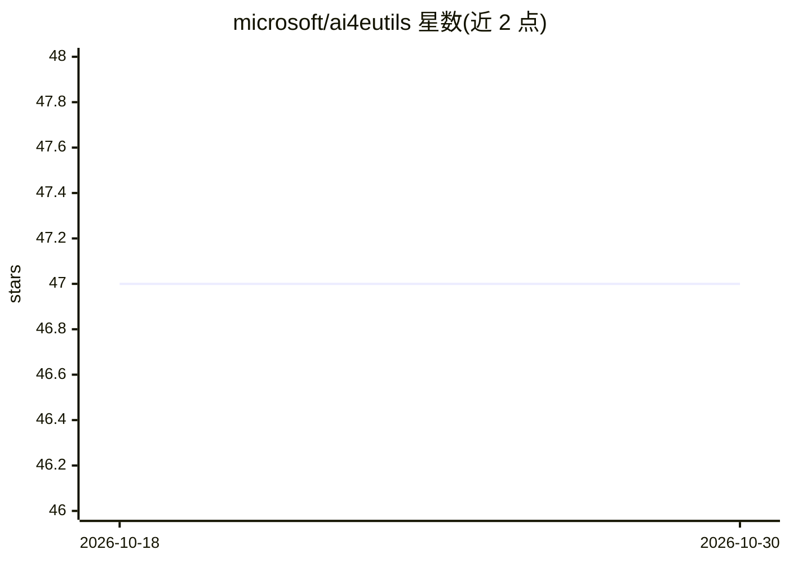

# microsoft/ai4eutils

⭐ 47 · Jupyter Notebook · MIT · 推送 2026-04-20 · [GitHub](https://github.com/microsoft/ai4eutils) · 组织维护

**微软 AI for Earth 团队的共享工具脚本集合**

微软 AI for Earth 团队维护的共享实用脚本仓库，供项目组成员与使用者复用。使用方式为将仓库顶层路径加入 Python path 后直接导入，仓库内其他包/模块均可假定可用；另设 scrap 目录存放一次性独立脚本。README 仅提供概览与贡献说明，未列出具体模块清单或安装命令。

## 筛选速览

| 维度 | 判定 | 备注 |
|---|---|---|
| AI 角色 | `ai-ecosystem` | LLM/agent 周边工具 |
| 许可风险 | `permissive` | MIT |
| 部署形态 | `None` |  |
| 模型依赖 | — | README 未给出锁定关系 |
| 硬件要求 | — | 无带数字的原话,不猜 |
| 安装摩擦 | `low` | 无编译、无系统依赖或容器化 |
| 成熟度 | — | 结构信号不足 |

## 能力要点

- 面向 AI for Earth 项目的共享实用脚本集合
- 通过将仓库顶层路径加入 Python path 的方式使用
- 设有 scrap 目录用于一次性独立脚本

## 适用场景

- AI for Earth 项目中复用团队的通用工具脚本
- 存放与共享一次性数据处理脚本

## 场景标签

 · 领域:环境科学/AI 工程工具

## 证据(README 行号)

> L3: Shared utilities developed by the Microsoft AI for Earth team
> L5: The general convention in this repo is that users who want to consume these utilities will add the top-level path of

## 星数曲线

2026-10-18 47 → 2026-10-30 47（+0）

---
*卡片 v1 · prompt 1.4 · 生成 2026-10-25 · 置信度 mid · 依据 README sha `56a6c4b0e658` · [字段定义](../../DATASET.md)*
