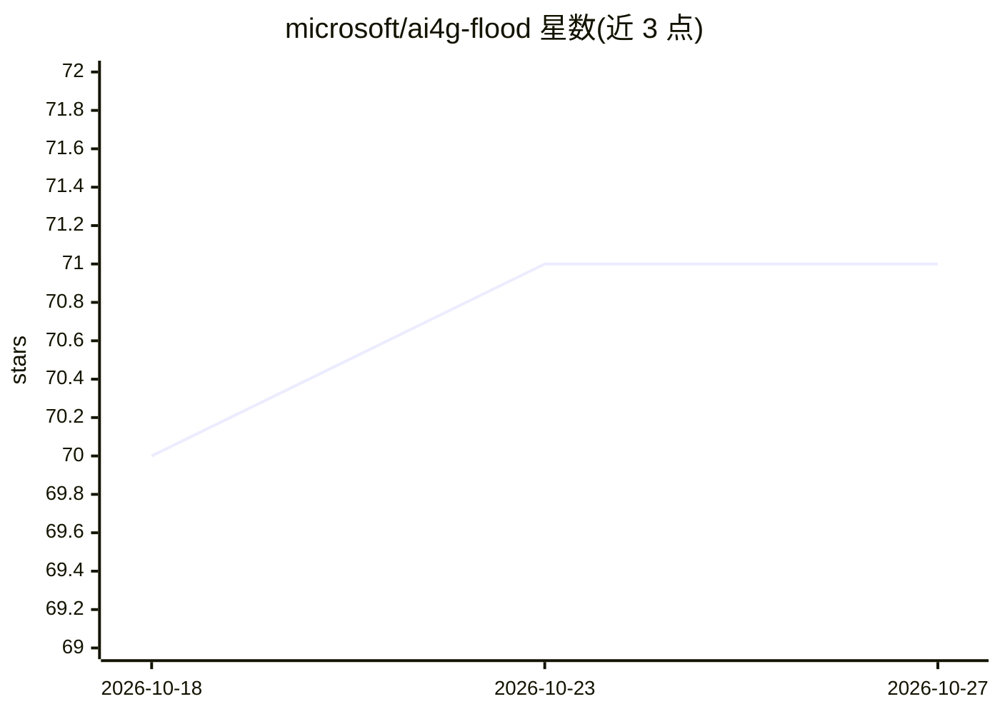

# microsoft/ai4g-flood

⭐ 71 · HTML · MIT · 推送 2025-11-04 · [GitHub](https://github.com/microsoft/ai4g-flood) · 组织维护

**用 SAR 卫星影像识别洪水淹没范围的检测模型工具包**

微软 AI for Good 团队的洪水检测工具包：基于 U-Net（MobileNetV2 编码器）模型，读取 Sentinel-1 SAR 影像（VV/VH 极化），生成二值洪水分布图。支持两种推理路径：从 Planetary Computer 按国家与时间范围大规模推理，以及对本地前后时相影像对推理；附带合并多幅预测栅格的工具。模型在 Planetary Computer 的 Sentinel-1 RTC 数据上训练，使用其他来源（如 ASF）需自行完成类似的辐射定标与地形校正预处理，结果可能存在差异。

## 筛选速览

| 维度 | 判定 | 备注 |
|---|---|---|
| AI 角色 | `ai-native` | 本体是模型或模型工具 |
| 许可风险 | `permissive` | MIT |
| 部署形态 | `library` | 以包/库形式分发 |
| 模型依赖 | — | README 未给出锁定关系 |
| 硬件要求 | — | 无带数字的原话,不猜 |
| 安装摩擦 | `low` | 无编译、无系统依赖或容器化 |
| 成熟度 | — | 结构信号不足 |

## 能力要点

- U-Net + MobileNetV2 架构，输入 VV/VH 双极化 SAR 影像，输出二值洪水图
- 支持 Planetary Computer 大规模推理与本地影像对推理两种路径
- 提供 merge 工具合并预测栅格并统一投影
- 可选用神经网络直接补全洪水范围以替代 80 米缓冲（实验性）

## 适用场景

- 灾害响应时快速制图某国某时段的洪水淹没范围
- 用自有的 Sentinel-1 RTC 影像对检测局部洪水
- 生成可用于 GIS 分析的合并洪水栅格产品

## 场景标签

`目标检测` · 领域:感知与多模态

## 证据(README 行号)

> L3: This repository contains a flood detection model that uses Synthetic Aperture Radar (SAR) imagery from the Planetary
> L124: The flood detection model is based on a U-Net architecture with a MobileNetV2 encoder. It takes SAR imagery (VV an

## 星数曲线

2026-10-18 70 → 2026-10-27 71（+1）

---
*卡片 v1 · prompt 1.4 · 生成 2026-10-24 · 置信度 high · 依据 README sha `e02f7bfd6749` · [字段定义](../../DATASET.md)*
