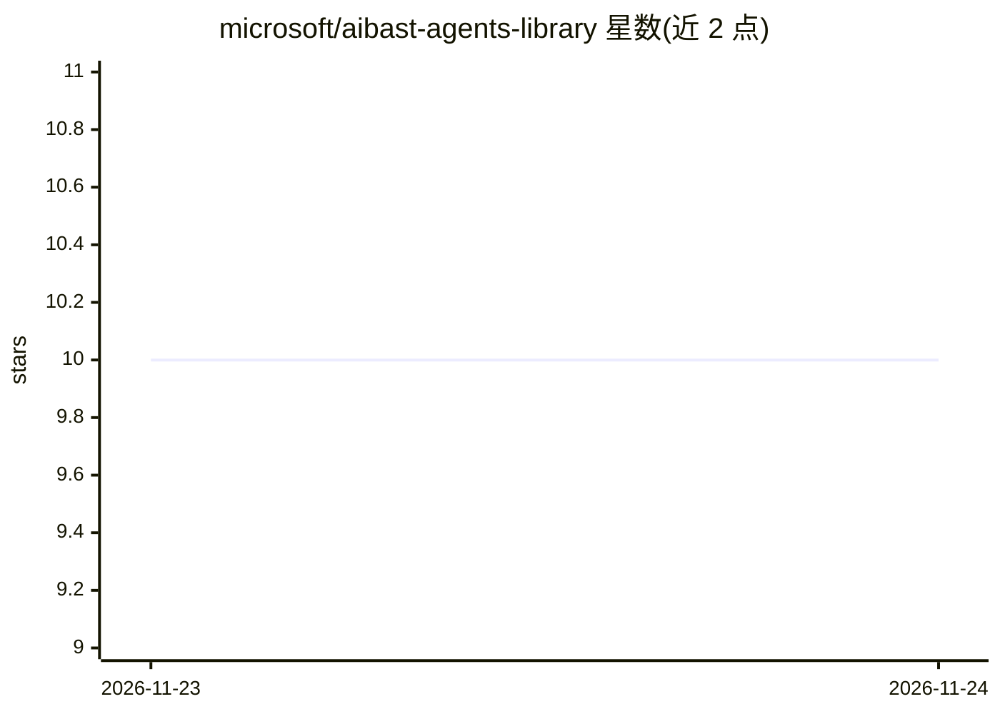

# microsoft/aibast-agents-library

⭐ 10 · HTML · MIT · 推送 2026-11-23 · [GitHub](https://github.com/microsoft/aibast-agents-library) · 组织维护

**给学习者的 Agent 模式学习与原型验证工具库**

由 Microsoft AIBAST 团队维护的实验性项目，包含行业 Agent 模板目录、RAPP 方法论和本地原型工具 Brainstem。Brainstem 是连接 GitHub Copilot API 的 Flask 服务器，用户定义 soul（系统提示词）并放入 Python agent 文件即可被自动发现注册为工具。定位为学习与原型验证工具而非交付产品，技能目标是迁移到 Copilot Studio 和 Microsoft 365 Copilot；分三层路径：本地 Brainstem、Azure 云部署（Function App + Azure OpenAI）、Copilot Studio 集成。核心聊天无需 API key，仅需带 Copilot 的 GitHub 账号。

## 筛选速览

| 维度 | 判定 | 备注 |
|---|---|---|
| AI 角色 | `ai-ecosystem` | LLM/agent 周边工具 |
| 许可风险 | `permissive` | MIT |
| 部署形态 | `None` |  |
| 模型依赖 | — | README 未给出锁定关系 |
| 硬件要求 | — | 无带数字的原话,不猜 |
| 安装摩擦 | `low` | 无编译、无系统依赖或容器化 |
| 成熟度 | `idea` | |

## 能力要点

- Brainstem 本地 Flask 服务器，*_agent.py 文件自动发现并注册为工具
- 72 个认证工作坊与按行业分组的 Agent 模板目录（stack）
- 三层进阶路径：本地 Brainstem → Azure 部署 → Copilot Studio/Teams
- 本地库指标统计与可分享的周/月度 PDF 报告生成脚本

## 适用场景

- 学习 agent 模式、函数调用与提示工程并在本地做原型
- 按行业场景查找并复制现成的 agent 模板到自己的流程
- 将本地验证过的 agent 逐步迁移到 Azure 和 Copilot Studio

## 场景标签

`教程课程` `Agent 框架` · 领域:Agent 开发

## 证据(README 行号)

> L7: Industry agent templates, the RAPP production methodology, and the RAPP Brainstem: a local frontier learning and rap
> L52: The brainstem is a Flask server that connects to GitHub Copilot's API for LLM inference. You define a **soul** (sys
> L63: Any `*_agent.py` file in your agents directory gets auto-discovered and registered as a tool:

## 星数曲线

2026-11-23 10 → 2026-11-24 10（+0）

---
*卡片 v1 · prompt 1.4 · 生成 2026-11-23 · 置信度 high · 依据 README sha `e1d9fa403548` · [字段定义](../../DATASET.md)*
