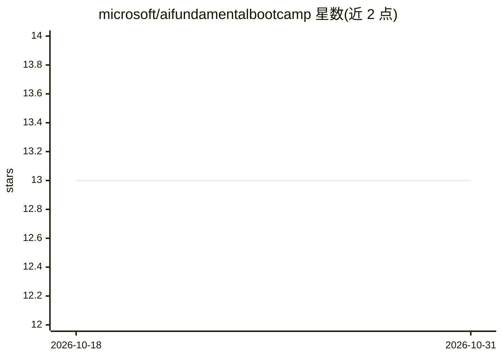

# microsoft/aifundamentalbootcamp

⭐ 13 · Jupyter Notebook · MIT · 推送 2026-04-21 · [GitHub](https://github.com/microsoft/aifundamentalbootcamp) · 组织维护

**微软应用创新 AI 基础训练营：8 课实操课程材料**

微软发起的应用创新基础训练营（LevelUP 引导式课程），包含 8 节课与配套实验（laboratories），面向希望掌握基础 AI 技能的团队，主题为大语言模型基础及其实际应用。课程内容取材自 Generative AI for Beginners 仓库，README 提供 Course Setup 章节指导开发环境搭建，并建议参与者结课后按自身节奏继续深入学习该来源仓库。

## 筛选速览

| 维度 | 判定 | 备注 |
|---|---|---|
| AI 角色 | `ai-knowledge` | 知识聚合/清单类 |
| 许可风险 | `permissive` | MIT |
| 部署形态 | `None` |  |
| 模型依赖 | — | README 未给出锁定关系 |
| 硬件要求 | — | 无带数字的原话,不猜 |
| 安装摩擦 | `low` | 无编译、无系统依赖或容器化 |
| 成熟度 | — | 结构信号不足 |

## 能力要点

- 8 节课与实验室的引导式训练营
- 内容取材自 Generative AI for Beginners 仓库
- 提供 Course Setup 开发环境搭建指引

## 适用场景

- 团队开展 AI 应用基础入门培训
- 了解大语言模型基础与实际应用场景

## 场景标签

`教程课程` · 领域:学习与行业

## 证据(README 行号)

> L3: This initiative is not merely about enhancing skills; it is about spearheading the future of innovation. We are comm
> L13: The material for this LevelUP session is derived from the Generative AI for Beginners repository. This session is d

## 星数曲线

2026-10-18 13 → 2026-10-31 13（+0）

---
*卡片 v1 · prompt 1.4 · 生成 2026-10-31 · 置信度 high · 依据 README sha `1c42d19260fb` · [字段定义](../../DATASET.md)*
