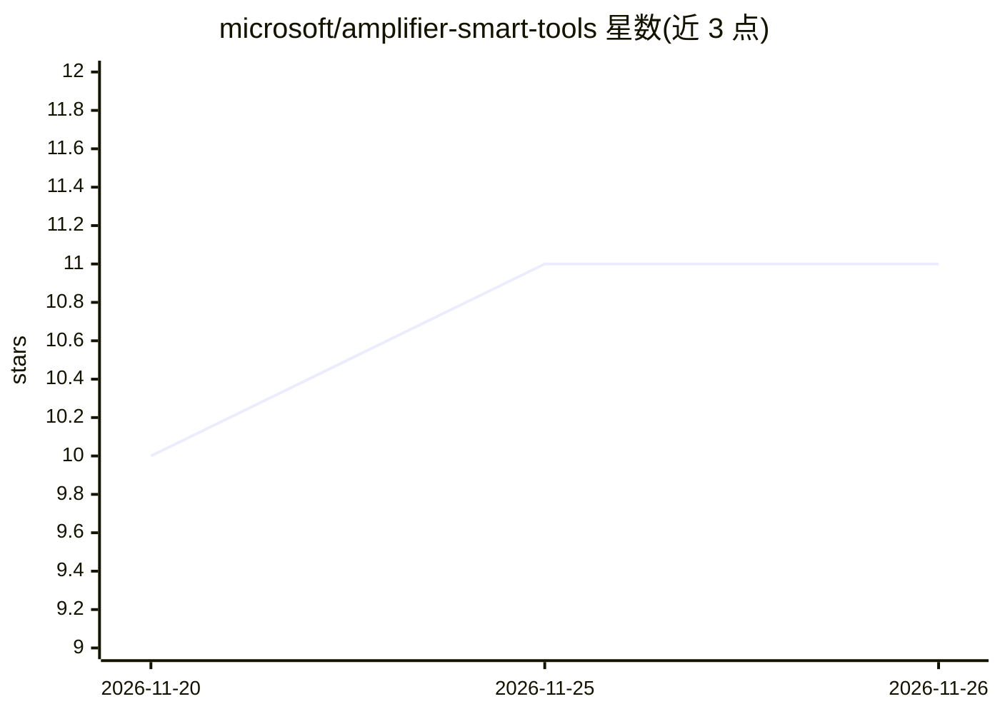

# microsoft/amplifier-smart-tools

⭐ 11 · Python · MIT · 推送 2026-11-19 · [GitHub](https://github.com/microsoft/amplifier-smart-tools) · [官网](https://microsoft.github.io/amplifier-smart-tools/) · 组织维护

**把领域专长打包为任意 agent 可调用工具的格式规范**

由微软维护的一项规范与配套工程：定义 Smart Tools 格式——每个工具自含库、清单（SMART_TOOL.md）与薄 CLI，内置自己的 agent harness，普通代码路径无需配置 AI provider 即可运行，高层命令则在内部调用 AI 完成任务。仓库包含规范文档、机器可执行的一致性检查套件、教会 agent 查找/安装/创建/发布该类工具的技能包，以及 Amplifier App 的 behavior 组合包。可通过 npx 安装技能，或在 Amplifier 中以 bundle add 组合进会话。

## 筛选速览

| 维度 | 判定 | 备注 |
|---|---|---|
| AI 角色 | `ai-ecosystem` | LLM/agent 周边工具 |
| 许可风险 | `permissive` | MIT |
| 部署形态 | `library` | 以包/库形式分发 |
| 模型依赖 | — | README 未给出锁定关系 |
| 硬件要求 | — | 无带数字的原话,不猜 |
| 安装摩擦 | `low` | 无编译、无系统依赖或容器化 |
| 成熟度 | — | 结构信号不足 |

## 能力要点

- 自含 agent harness，在 Copilot、Claude Code、语音助手等不同宿主中行为一致
- 既是库/CLI 也内嵌 AI 能力，无 AI provider 时普通代码路径仍可运行
- 一致性套件提供机器可执行检查，无法检查的规则报告 SKIP 而非伪造 PASS
- 附带教授 agent 查找、安装、调用、创建、发布 Smart Tools 的技能

## 适用场景

- 把领域工作流封装成可被多个 agent 宿主复用的工具
- 让自家应用、脚本或作业以库形式直接集成智能工具
- 发布前用一致性套件验证工具是否符合规范

## 场景标签

`工作流自动化` · 领域:效率与自动化

## 证据(README 行号)

> L3: Smart Tools is a format for packaging domain expertise into tools that any agent can use.
> L35: Smart Tools bring their own "agent harnesses" inside which can be isolated without living inside another host and t
> L41: Agent Skills gave users a way to share prompts and scripts, and MCP gave users a way to connect agents to more thin

## 星数曲线

2026-11-20 10 → 2026-11-26 11（+1）

---
*卡片 v1 · prompt 1.4 · 生成 2026-11-20 · 置信度 high · 依据 README sha `9d706c48d9f7` · [字段定义](../../DATASET.md)*
