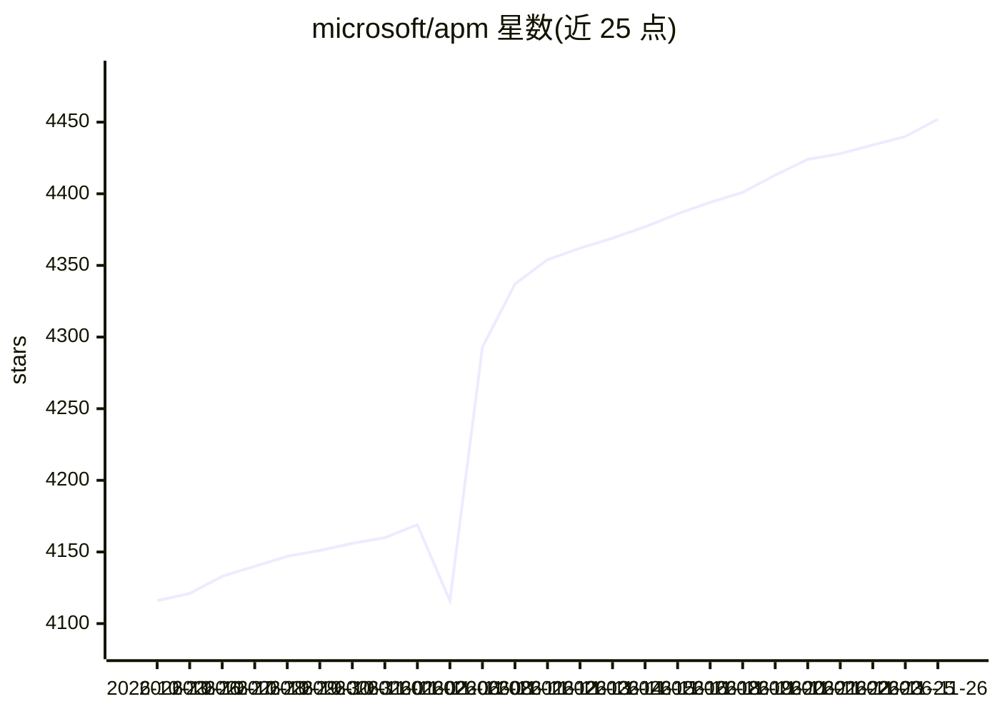

# microsoft/apm

⭐ 4,452 · Python · Apache-2.0 · 推送 2026-11-25 · [GitHub](https://github.com/microsoft/apm) · [官网](https://microsoft.github.io/apm/) · 组织维护

**给团队统一管理 agent 技能、插件与 MCP 服务器依赖的包管理器**

APM 将编码 agent 加载的技能、指令、提示、插件与 MCP 服务器当作依赖管理：在 apm.yml 中声明一次，apm install 按每个 harness 的自有格式写入文件，并在 apm.lock.yaml 记录精确 commit 与逐文件 SHA-256 哈希，支持传递依赖解析与 GitHub Action CI 安装。安全机制包括锁定完整性校验、漂移检测、隐藏 Unicode 内容扫描与 hooks/MCP 可执行审批；apm-policy.yml 支持组织级来源/可执行策略并可通过 apm audit --ci 在 PR 中强制执行。安装提供 Homebrew、curl/PowerShell 脚本、pip、WinGet、Scoop 多渠道。

## 筛选速览

| 维度 | 判定 | 备注 |
|---|---|---|
| AI 角色 | `ai-ecosystem` | LLM/agent 周边工具 |
| 许可风险 | `permissive` | Apache-2.0 |
| 部署形态 | `library` | 以包/库形式分发 |
| 模型依赖 | — | README 未给出锁定关系 |
| 硬件要求 | — | 无带数字的原话,不猜 |
| 安装摩擦 | `low` | 无编译、无系统依赖或容器化 |
| 成熟度 | — | 结构信号不足 |

## 能力要点

- 一份 apm.yml 声明，写入 9 种 harness 的各自格式，lockfile 逐文件 SHA-256 固定
- 从 GitHub/GitLab/Azure DevOps/git URL 安装技能与插件，含传递依赖解析
- apm audit 提供漂移检测、隐藏 Unicode 扫描与 CycloneDX/SPDX 清单导出
- apm-policy.yml 组织级策略支持 warn/block 模式与 PR 门禁

## 适用场景

- 团队多仓库统一分发经过审批的技能、插件与 MCP 服务器
- CI 中校验 agent 依赖与 lockfile 一致，防止配置漂移
- 替代手工编辑各工具的 MCP JSON 配置文件
- 为 agent 供应链建立组织级来源与可执行审批策略

## 场景标签

 · 领域:开发工具/依赖管理

## 证据(README 行号)

> L3: **An open-source, community-driven dependency manager for the agent supply chain.**
> L18: **APM treats them as dependencies.** Declare them once in `apm.yml`. `apm install` writes each one in every harness
> L86: Teams that run coding agents at scale end up building the same thing: a central team publishes approved skills, plu

## 星数曲线

2026-10-23 4,116 → 2026-11-26 4,452（+336）

---
*卡片 v1 · prompt 1.4 · 生成 2026-11-24 · 置信度 mid · 依据 README sha `991faec6def2` · [字段定义](../../DATASET.md)*
