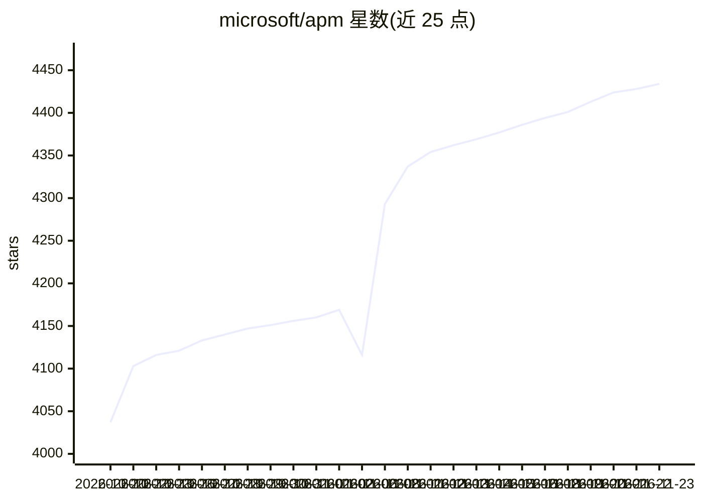

# microsoft/apm

⭐ 4,434 · Python · Apache-2.0 · 推送 2026-11-22 · [GitHub](https://github.com/microsoft/apm) · [官网](https://microsoft.github.io/apm/) · 组织维护

**给团队管理 agent 依赖的包管理器：一份清单装遍多种编码 agent**

面向使用编码 agent 的团队，将 skills、prompts、plugins、MCP servers 等纳入依赖管理：apm.yml 声明依赖，apm install 按各 harness（Claude Code、GitHub Copilot、Cursor、Codex 等）自有格式写入文件，apm.lock.yaml 记录 commit 与 SHA-256 哈希实现可复现安装与漂移检测；apm audit 做 CI 检查，apm-policy.yml 支持组织级来源与可执行文件策略（先 warn 后 block）。包来自 git，无需账号与注册表。提供 brew、pip、WinGet、Scoop 及原生二进制安装。

## 筛选速览

| 维度 | 判定 | 备注 |
|---|---|---|
| AI 角色 | `ai-ecosystem` | LLM/agent 周边工具 |
| 许可风险 | `permissive` | Apache-2.0 |
| 部署形态 | `library` | 以包/库形式分发 |
| 模型依赖 | locked-api |  |
| 硬件要求 | — | 无带数字的原话,不猜 |
| 安装摩擦 | `low` | 无编译、无系统依赖或容器化 |
| 成熟度 | — | 结构信号不足 |

## 能力要点

- 一份 manifest 写入各 harness 自有格式，含传递依赖解析
- lockfile 记录 commit 与 SHA-256，支持 --frozen 复现与 apm audit 漂移检测
- 安装时扫描隐藏 Unicode 内容，apm approve 审批 hooks 与 MCP server 部署
- org policy 支持 warn/block 模式与 CycloneDX/SPDX 清单导出

## 适用场景

- 让团队所有仓库用同一份清单安装相同的 skills 与 MCP server
- 在 CI/PR 中检查 agent 依赖漂移与来源合规
- 建组织内部 marketplace 统一分发审批过的插件

## 场景标签

 · 领域:AI 生态/开发工具链

## 证据(README 行号)

> L3: **An open-source, community-driven dependency manager for the agent supply chain.**
> L18: **APM treats them as dependencies.** Declare them once in `apm.yml`. `apm install` writes each one in every harness
> L86: Teams that run coding agents at scale end up building the same thing: a central team publishes approved skills, plu

## 星数曲线

2026-10-20 4,037 → 2026-11-23 4,434（+397）

---
*卡片 v1 · prompt 1.4 · 生成 2026-11-22 · 置信度 mid · 依据 README sha `9508c1edffd5` · [字段定义](../../DATASET.md)*
