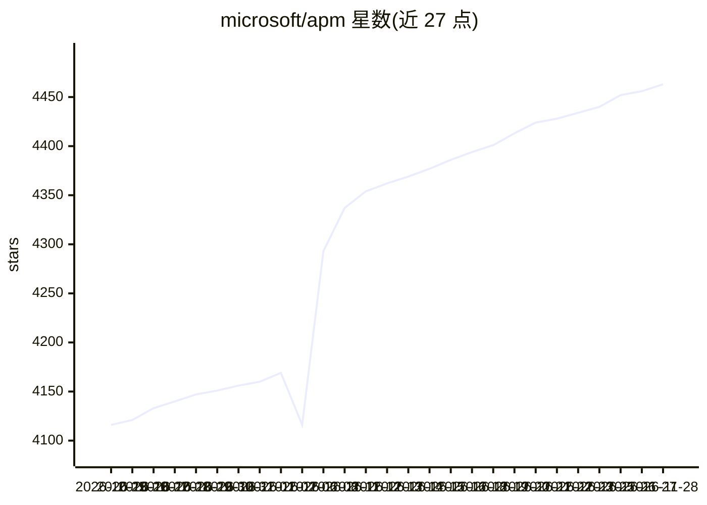

# microsoft/apm

⭐ 4,463 · Python · Apache-2.0 · 推送 2026-11-26 · [GitHub](https://github.com/microsoft/apm) · [官网](https://microsoft.github.io/apm/) · 组织维护

**为 AI 编码 agent 管理技能/插件/MCP 依赖的包管理器**

APM 将 coding agent 加载的技能、指令、提示词、hooks、插件与 MCP 服务器当作依赖管理：apm.yml 声明一次，apm install 按每个工具各自的配置格式写入并记录 commit 与 SHA-256 到 apm.lock.yaml，支持传递依赖解析与 GitHub Action CI 安装。面向在多仓库、多 agent 工具环境下协作的团队，提供完整性校验、漂移检测、内容扫描、审批机制与组织级策略（apm-policy.yml）在 PR 上强制执行。定位是依赖管理层，不充当沙箱。

## 筛选速览

| 维度 | 判定 | 备注 |
|---|---|---|
| AI 角色 | `ai-ecosystem` | LLM/agent 周边工具 |
| 许可风险 | `permissive` | Apache-2.0 |
| 部署形态 | `library` | 以包/库形式分发 |
| 模型依赖 | — | README 未给出锁定关系 |
| 硬件要求 | — | 无带数字的原话,不猜 |
| 安装摩擦 | `low` | 无编译、无系统依赖或容器化 |
| 成熟度 | — | 结构信号不足 |

## 能力要点

- 一份 manifest 写入 Copilot/Claude Code/Cursor 等九种 harness 各自格式
- lockfile 记录 commit 与 SHA-256，哈希不符即拒绝
- apm audit 做漂移检测与 PR 门禁，支持 CycloneDX/SPDX 导出
- org policy 支持 warn/block 模式与审批 hooks/MCP 服务器

## 适用场景

- 团队统一管理多仓库的 agent 技能与 MCP 服务器依赖
- 在 CI 中校验 agent 配置未漂移或引入未审批来源
- 企业通过内部 marketplace 分发审批过的插件与技能

## 场景标签

`提示工程` · 领域:Agent 开发

## 证据(README 行号)

> L3: **An open-source, community-driven dependency manager for the agent supply chain.**
> L18: **APM treats them as dependencies.** Declare them once in `apm.yml`. `apm install` writes each one in every harness
> L86: Teams that run coding agents at scale end up building the same thing: a central team publishes approved skills, plu

## 星数曲线

2026-10-25 4,116 → 2026-11-28 4,463（+347）

---
*卡片 v1 · prompt 1.4 · 生成 2026-11-26 · 置信度 mid · 依据 README sha `a89a30904201` · [字段定义](../../DATASET.md)*
