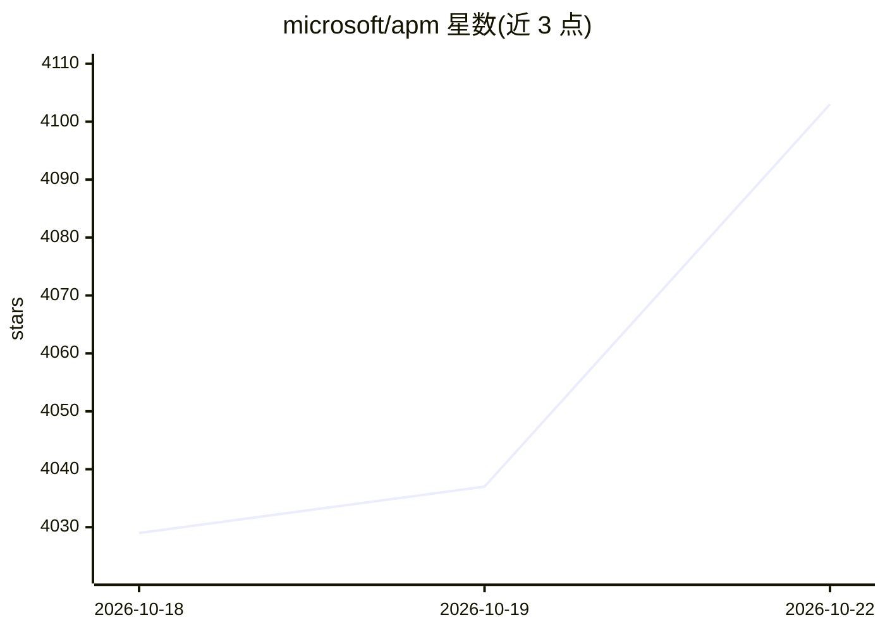

# microsoft/apm

⭐ 4,103 · Python · MIT · 推送 2026-10-21 · [GitHub](https://github.com/microsoft/apm) · [官网](https://microsoft.github.io/apm/) · 组织维护

**AI 编程代理的依赖管理器：一份清单配置所有 agent**

微软开源的 AI agent 配置依赖管理工具：用 apm.yml 声明项目的指令、技能、提示词、插件、MCP server 等上下文依赖，apm install 一次命令在 GitHub Copilot、Claude Code、Codex、Cursor、Gemini、Windsurf、Kiro 等多个客户端间复现同一配置，支持传递依赖解析与 lockfile 锁定。安全方面安装时扫描隐藏 Unicode、lockfile 记录内容哈希、可导出 SBOM、传递性 MCP server 需信任确认；apm-policy.yml 支持企业到仓库的只紧不松策略继承。提供 brew、curl 脚本、pip、WinGet、Scoop 等安装方式。

## 筛选速览

| 维度 | 判定 | 备注 |
|---|---|---|
| AI 角色 | `ai-ecosystem` | LLM/agent 周边工具 |
| 许可风险 | `permissive` | MIT |
| 部署形态 | `library` | 以包/库形式分发 |
| 模型依赖 | — | README 未给出锁定关系 |
| 硬件要求 | — | 无带数字的原话,不猜 |
| 安装摩擦 | `low` | 无编译、无系统依赖或容器化 |
| 成熟度 | — | 结构信号不足 |

## 能力要点

- apm.yml 单一清单描述 instructions/skills/prompts/hooks/plugins/MCP servers，跨 9 个 agent 客户端复现
- lockfile 锁定解析树与内容哈希，支持 CycloneDX/SPDX SBOM 导出与漂移检测
- apm-policy.yml 组织级策略治理：只紧不松继承、CI 门禁、GitHub rulesets 集成
- 支持插件编写（plugin.json 导出）、marketplace 安装与 GitHub Action CI/CD

## 适用场景

- 团队克隆仓库后一条命令配齐所有 AI agent 上下文依赖
- 安全团队用策略文件限制组织内可安装的来源与范围
- 把 agent 配置打包为插件或 SBOM 供采购/审计使用

## 场景标签

 · 领域:开发者工具/Agent 基础设施

## 证据(README 行号)

> L3: **An open-source, community-driven dependency manager for AI agents.**
> L18: **APM fixes this.** Declare your project's agentic dependencies once in `apm.yml`, and every developer who clones y
> L53: One `apm.yml` describes every primitive your agents need — instructions, skills, prompts, agents, hooks, plugins, M

## 星数曲线

2026-10-18 4,029 → 2026-10-22 4,103（+74）

---
*卡片 v1 · prompt 1.4 · 生成 2026-10-20 · 置信度 mid · 依据 README sha `bca98f655dc7` · [字段定义](../../DATASET.md)*
