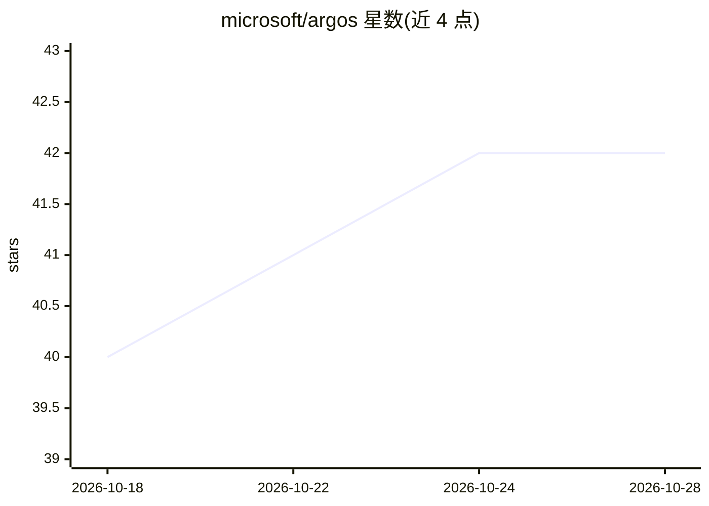

# microsoft/argos

⭐ 42 · Python · MIT · 推送 2026-10-27 · [GitHub](https://github.com/microsoft/argos) · 组织维护

**用 LLM agent 自动生成可解释时序异常检测规则的系统**

微软发布的研究型 agentic 系统，通过 LLM agent 流水线（DetectionAgent → RepairAgent → ReviewAgent）在时间序列数据集上自动训练可解释、可复现的异常检测规则，另有 MutateAgent 的进化训练模式。支持 one-for-one 与 one-for-all 两种数据集模式和三种训练模式。依赖 Azure OpenAI API，提供 driver.py 命令行驱动与数据预处理脚本。定位为供领域专家审核使用的研究工具，不推荐直接部署到生产监控或高风险场景。

## 筛选速览

| 维度 | 判定 | 备注 |
|---|---|---|
| AI 角色 | `ai-native` | 本体是模型或模型工具 |
| 许可风险 | `permissive` | MIT |
| 部署形态 | `library` | 以包/库形式分发 |
| 模型依赖 | locked-api |  |
| 硬件要求 | — | 无带数字的原话,不猜 |
| 安装摩擦 | `low` | 无编译、无系统依赖或容器化 |
| 成熟度 | `idea` | |

## 能力要点

- LLM agent 流水线自动生成可解释异常检测规则
- 三种训练模式：单管线、并行管线、进化变异
- 支持 KPI 与 Yahoo 数据集的预处理脚本
- 输出规则文件及逐轮 train/validation/test 评估结果

## 适用场景

- 为云基础设施监控生成供人工审核的异常检测规则
- 复现论文结果或开展时序异常检测研究
- 跨多条时间序列训练可泛化的异常规则

## 场景标签

`科研工具` · 领域:学习与行业

## 证据(README 行号)

> L9: Argos employs LLMs to autonomously generate explainable and reproducible rules.
> L97: Argos relies on LLM agents to train anomaly rules on the training dataset.
> L17: - Argos is being shared with the research community to facilitate reproduction of our results and foster further re

## 星数曲线

2026-10-18 40 → 2026-10-28 42（+2）

---
*卡片 v1 · prompt 1.4 · 生成 2026-10-25 · 置信度 mid · 依据 README sha `99cc863c821f` · [字段定义](../../DATASET.md)*
