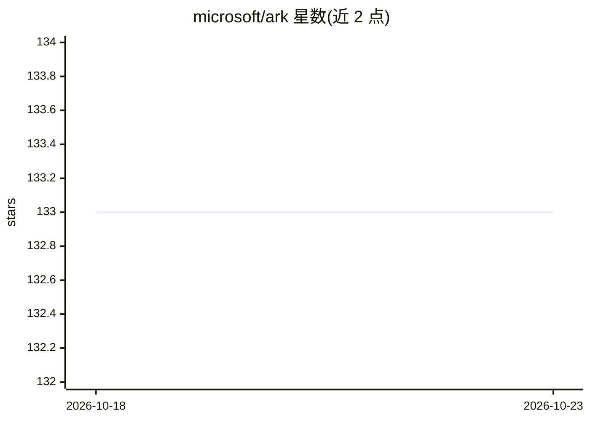

# microsoft/ark

⭐ 133 · C++ · MIT · 推送 2026-08-20 · [GitHub](https://github.com/microsoft/ark) · 组织维护

**分布式 GPU 深度学习执行框架：GPU 自主调度计算与通信**

微软与 KAIST 合作的研究项目，提供面向分布式 GPU 深度学习应用的 API：用户表达应用后，ARK 自动生成 GPU 驱动的执行计划，产出一个循环执行的 loop kernel，在 GPU 上自主调度计算与通信、无需 CPU 介入。v0.5 集成 MSCCL++、支持 AMD CDNA3 架构与 AMD GPU 通信，并附多 GPU Llama2 示例。项目声明仍在活跃开发中，部分功能留待后续版本，有 NSDI'23 论文可引用。面向分布式训练/系统研究人员与开发者。

## 筛选速览

| 维度 | 判定 | 备注 |
|---|---|---|
| AI 角色 | `ai-ecosystem` | LLM/agent 周边工具 |
| 许可风险 | `permissive` | MIT |
| 部署形态 | `None` |  |
| 模型依赖 | — | README 未给出锁定关系 |
| 硬件要求 | — | 无带数字的原话,不猜 |
| 安装摩擦 | `medium` | 含编译或系统依赖之一 |
| 成熟度 | `idea` | |

## 能力要点

- GPU 驱动执行模型：计算与通信均由 GPU 自主调度，无需 CPU 介入
- 自动生成 loop kernel，在分布式 GPU 上迭代执行整个应用
- v0.5 支持 AMD CDNA3 架构与 AMD GPU 通信，集成 MSCCL++
- 提供多 GPU Llama2 示例

## 适用场景

- 编写在多 GPU 集群上运行的分布式深度学习应用
- 研究 GPU 自主调度计算与通信的系统架构
- 复现论文中的分布式执行机制并进行系统实验

## 场景标签

`模型训练` · 领域:训练与推理

## 证据(README 行号)

> L19: ARK is a deep learning framework especially designed for highly optimized performance over distributed GPUs. Specif
> L21: ARK provides a set of APIs for users to express their distributed deep learning applications. ARK then automaticall

## 星数曲线

2026-10-18 133 → 2026-10-23 133（+0）

---
*卡片 v1 · prompt 1.4 · 生成 2026-10-22 · 置信度 high · 依据 README sha `5713b43d94c1` · [字段定义](../../DATASET.md)*
