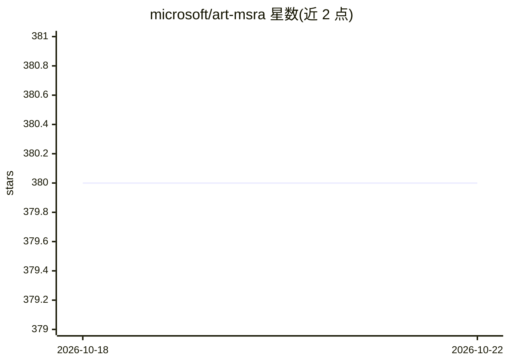

# microsoft/art-msra

⭐ 380 · Jupyter Notebook · MIT · 推送 2026-04-08 · [GitHub](https://github.com/microsoft/art-msra) · 组织维护

**多层透明图像生成模型 ART 的官方仓库（权重与代码已撤除）**

CVPR 2025 论文 ART（Anonymous Region Transformer）官方仓库：基于全局文本提示与匿名区域布局（无逐层说明的边界框）生成由多层 RGBA 图像层构成的多层透明图像，支持 50+ 层，布局可由 LLM 预测或人工指定。2025/07/23 起因训练数据来源问题，预训练权重、推理与训练代码均已移除，当前无可运行或可复现的模型使用途径。

## 筛选速览

| 维度 | 判定 | 备注 |
|---|---|---|
| AI 角色 | `ai-native` | 本体是模型或模型工具 |
| 许可风险 | `permissive` | MIT |
| 部署形态 | `None` |  |
| 模型依赖 | — | README 未给出锁定关系 |
| 硬件要求 | — | 无带数字的原话,不猜 |
| 安装摩擦 | `low` | 无编译、无系统依赖或容器化 |
| 成熟度 | — | 结构信号不足 |

## 能力要点

- 全局提示 + 匿名区域布局生成多层 RGBA 透明图像
- 支持 50+ 层的复杂多层输出
- 布局可由 LLM 预测或用户手动指定

## 适用场景

- 查阅 ART 多层透明图像生成方法的论文与说明
- 了解匿名区域布局机制的设计思路

## 场景标签

`图像生成` · 领域:内容生成

## 证据(README 行号)

> L1: ART: Anonymous Region Transformer for Variable Multi-Layer Transparent Image Generation
> L5:  This repository supports generating multi-layer transparent images (constructed with multiple RGBA image layers) ba

## 星数曲线

2026-10-18 380 → 2026-10-22 380（+0）

---
*卡片 v1 · prompt 1.4 · 生成 2026-10-21 · 置信度 high · 依据 README sha `b7e73e56dc93` · [字段定义](../../DATASET.md)*
