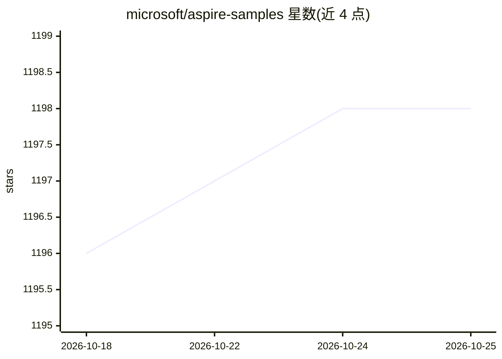

# microsoft/aspire-samples

⭐ 1,198 · C# · MIT · 推送 2026-10-25 · [GitHub](https://github.com/microsoft/aspire-samples) · [官网](https://aspire.dev/reference/samples/) · 组织维护

**微软 Aspire 的官方示例集合，覆盖多语言云原生与 AI 场景**

微软维护的 .NET Aspire 官方示例仓库，按场景组织数十个可运行的示例工程：全栈 JavaScript/TypeScript、多语言全栈（Python/Java/Go/C#）、后端集成、交互式终端、云/AI/事件驱动（含 RAG 问答、Python OpenAI Agent、Azure Functions、指标可视化）等。示例使用 Aspire 13.6.0 CLI 与 SDK，README 给出安装命令；附带 devcontainer 配置与 eShop 参考应用。示例仅供演示概念，声明不适用于生产环境。

## 筛选速览

| 维度 | 判定 | 备注 |
|---|---|---|
| AI 角色 | `ai-knowledge` | 知识聚合/清单类 |
| 许可风险 | `permissive` | MIT |
| 部署形态 | `self-host` | docker 或自建部署 |
| 模型依赖 | — | README 未给出锁定关系 |
| 硬件要求 | — | 无带数字的原话,不猜 |
| 安装摩擦 | `low` | 无编译、无系统依赖或容器化 |
| 成熟度 | — | 结构信号不足 |

## 能力要点

- 按 6 类场景组织的多语言示例（C#/JS/TS/Python/Go/Java）
- 含 RAG 文档问答与 Python OpenAI Agent 等 AI 示例
- 提供 devcontainer/Codespaces 环境与 eShop 参考应用
- 随 Aspire 13.6.0 版本发布并含 CI 配置

## 适用场景

- 学习如何用 Aspire 集成前后端、容器与数据库
- 参考 RAG 问答或 AI agent 在 Aspire 中的写法
- 在 Codespaces 中快速搭建示例开发环境

## 场景标签

`教程课程` · 领域:学习与行业

## 证据(README 行号)

> L5: Samples for Aspire.
> L7: Aspire is a developer-first toolset that streamlines integrating front-ends, APIs, containers, and databases with yo
> L29: ## Browse by scenario

## 星数曲线

2026-10-18 1,196 → 2026-10-25 1,198（+2）

---
*卡片 v1 · prompt 1.4 · 生成 2026-10-21 · 置信度 mid · 依据 README sha `43484eaf4b8d` · [字段定义](../../DATASET.md)*
