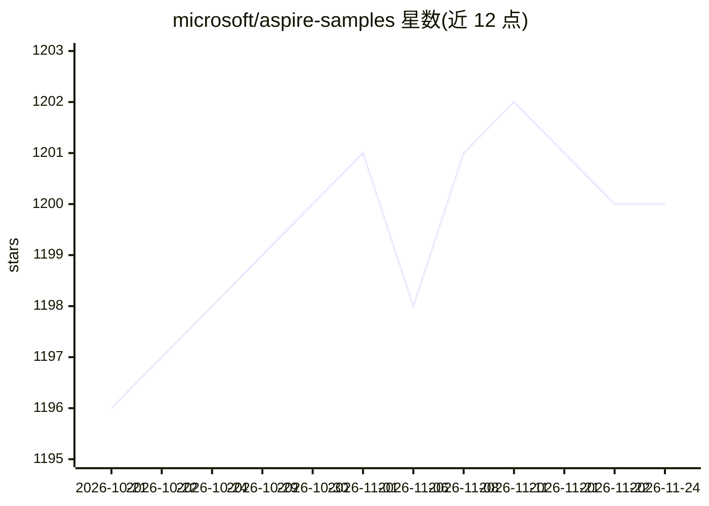

# microsoft/aspire-samples

⭐ 1,200 · C# · MIT · 推送 2026-11-20 · [GitHub](https://github.com/microsoft/aspire-samples) · [官网](https://aspire.dev/reference/samples/) · 组织维护

**Aspire 开发者工具集的多语言场景示例集**

微软 Aspire 的官方示例仓库，按场景组织示例应用：前端集成（React/Vue/Angular）、多语言全栈（Python/Java/Go/Node 与 .NET 混合）、交互式终端、云/AI/事件驱动等。每个示例标注工作负载语言、AppHost 类型与部署方式（Run only/Docker Compose/Azure）。运行前需安装匹配版本的 Aspire CLI（17.0.0），另提供 Dev Container 与 GitHub Codespaces 配置。README 声明代码仅用于演示概念，不用于生产部署。

## 筛选速览

| 维度 | 判定 | 备注 |
|---|---|---|
| AI 角色 | `ai-knowledge` | 知识聚合/清单类 |
| 许可风险 | `permissive` | MIT |
| 部署形态 | `self-host` | docker 或自建部署 |
| 模型依赖 | — | README 未给出锁定关系 |
| 硬件要求 | — | 无带数字的原话,不猜 |
| 安装摩擦 | `low` | 无编译、无系统依赖或容器化 |
| 成熟度 | — | 结构信号不足 |

## 能力要点

- 按场景分类的示例目录：前端、Polyglot 全栈、后端集成、终端、云/AI
- 多语言 AppHost 支持：C#、TypeScript、Go 编写的 AppHost
- 提供 Dev Container 与 GitHub Codespaces 开发环境配置
- 含 eShop 电商参考应用

## 适用场景

- 学习如何用 Aspire 编排前端、API、容器与数据库
- 参考 FastAPI/Go/Java 应用与 .NET 的集成方式
- 在 Codespaces 中快速运行分布式应用示例

## 场景标签

`教程课程` · 领域:学习与行业

## 证据(README 行号)

> L5: Samples for Aspire.
> L30: ## Browse by scenario

## 星数曲线

2026-10-21 1,196 → 2026-11-24 1,200（+4）

---
*卡片 v1 · prompt 1.4 · 生成 2026-11-23 · 置信度 mid · 依据 README sha `b132c37ae1ad` · [字段定义](../../DATASET.md)*
