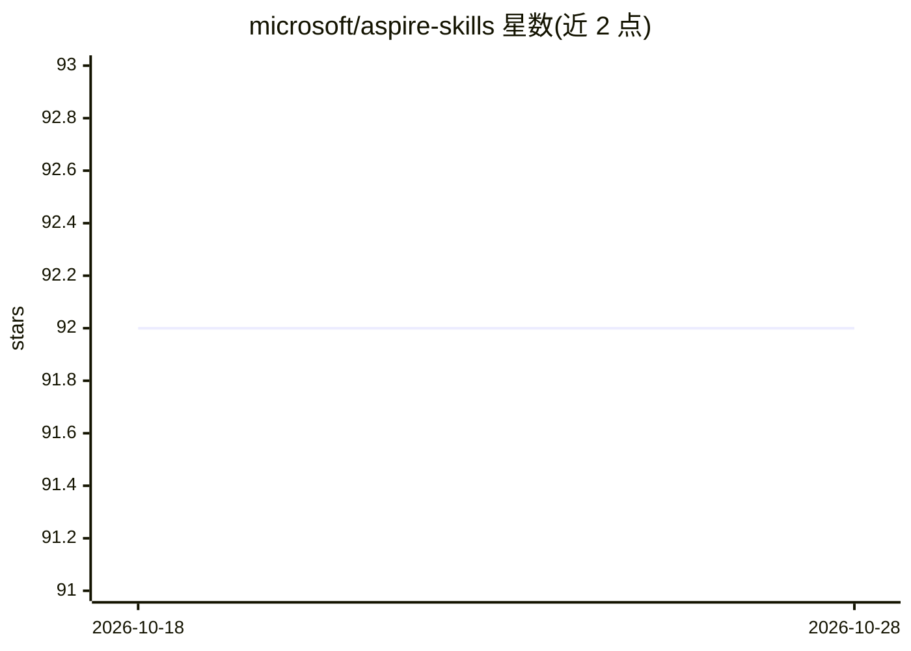

# microsoft/aspire-skills

⭐ 93 · JavaScript · MIT · 推送 2026-10-28 · [GitHub](https://github.com/microsoft/aspire-skills) · [官网](https://aspire.dev/get-started/aspire-skills/) · 组织维护

**微软官方 Aspire 技能包：让 AI 编码代理正确操作 Aspire 分布式应用**

面向 Aspire 分布式应用开发的 AI 编码代理插件/技能包：提供 7 个技能（项目初始化、AppHost 接线、Project v2 迁移、资源编排、部署、监控路由等）与 3 个 Copilot 应用画布扩展，使代理识别 Aspire 工作区、按 CLI 规范执行任务，替代临时 dotnet/curl/Docker/shell 工作流。支持 Aspire CLI 一等安装、GitHub Copilot 应用/CLI、Claude Code、Gemini CLI、Cursor、Codex、OpenCode、Ollama+Copilot 及 skills.sh 多通道安装；MCP 配置为可选。捆绑包声明 Aspire CLI/SDK 兼容范围 >=13.5.0 <13.7.0。

## 筛选速览

| 维度 | 判定 | 备注 |
|---|---|---|
| AI 角色 | `ai-ecosystem` | LLM/agent 周边工具 |
| 许可风险 | `permissive` | MIT |
| 部署形态 | `library` | 以包/库形式分发 |
| 模型依赖 | local-ok | 支持本地模型 |
| 硬件要求 | — | 无带数字的原话,不猜 |
| 安装摩擦 | `medium` | 含编译或系统依赖之一 |
| 成熟度 | — | 结构信号不足 |

## 能力要点

- 7 个 Aspire 技能覆盖初始化、编排、部署、监控、迁移等任务
- 支持 8+ 种代理宿主安装通道（Aspire CLI、Copilot、Claude Code、Gemini CLI、Cursor、Codex、OpenCode、skills.sh）
- 发布包含技能清单与遥测钩子的 commit/SHA-512 溯源记录
- MCP 服务器配置为 opt-in，默认不开启

## 适用场景

- 让 AI 编码代理在 Aspire 项目中正确使用 CLI 完成初始化与部署
- 将代理的常见操作路由到专用技能而非临时 shell 命令
- 通过 GitHub Copilot 应用画布扩展可视化查看 doctor 检查与资源计划

## 场景标签

 · 领域:软件开发/分布式应用工具链

## 证据(README 行号)

> L3: Aspire Skills is a plugin, skill pack, and extension pack for AI coding agents working on Aspire distributed applica
> L5: It helps agents recognize Aspire workspaces, use the Aspire CLI correctly, route common work to focused skills inste

## 星数曲线

2026-10-18 92 → 2026-10-28 92（+0）

---
*卡片 v1 · prompt 1.4 · 生成 2026-10-23 · 置信度 high · 依据 README sha `8376ff3ecc6b` · [字段定义](../../DATASET.md)*
