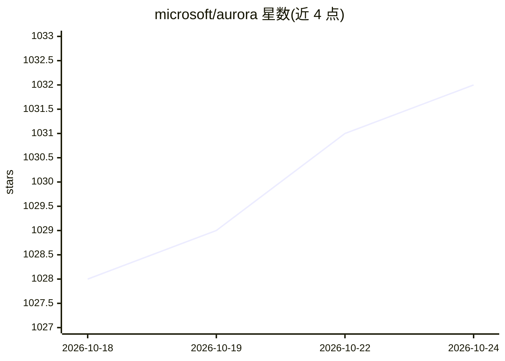

# microsoft/aurora

⭐ 1,032 · Python · NOASSERTION · 推送 2026-10-14 · [GitHub](https://github.com/microsoft/aurora) · [官网](https://microsoft.github.io/aurora) · 组织维护

**微软地球系统预报基础模型 Aurora 的官方实现**

Aurora 是用于地球系统预报的机器学习基础模型：先在大规模数据上通用预训练，再用少量数据适配专门任务。官方提供四个专门版本：中分辨率天气预报、高分辨率天气预报、空气污染预报、海洋波浪预报。以 Python 库（pip/conda 安装）发布，附带预训练权重（首次运行下载约 500 MB），可在 ERA5 数据上运行完整示例。README 声明该代码面向学术研究与论文复现，未针对非学术用途开发或测试，不适用于无专家审核的运营决策。

## 筛选速览

| 维度 | 判定 | 备注 |
|---|---|---|
| AI 角色 | `ai-native` | 本体是模型或模型工具 |
| 许可风险 | `none` | NOASSERTION |
| 部署形态 | `library` | 以包/库形式分发 |
| 模型依赖 | — | README 未给出锁定关系 |
| 硬件要求 | — | 无带数字的原话,不猜 |
| 安装摩擦 | `medium` | 含编译或系统依赖之一 |
| 成熟度 | — | 结构信号不足 |

## 能力要点

- 基础模型架构，可用少量数据适配专门大气预报任务
- 提供中/高分辨率天气、空气污染、海洋波浪四个专门版本
- pip/conda 安装，附预训练权重与 ERA5 完整示例
- 训练数据覆盖 ERA5、CMIP6、HRES、GFS、CAMS 等公开数据集

## 适用场景

- 研究大气变量（如温度）的预报预测
- 复现 Aurora 论文实验结果
- 用少量任务数据微调适配专门预报任务
- 评估极端天气事件下的模型行为

## 场景标签

`微调` · 领域:训练与推理

## 证据(README 行号)

> L38: Aurora is a machine learning model that can predict atmospheric variables, such as temperature.
> L96: Aurora is intended for medium- and high-resolution weather prediction, air pollution forecasting, ocean wave predic

## 星数曲线

2026-10-18 1,028 → 2026-10-24 1,032（+4）

---
*卡片 v1 · prompt 1.4 · 生成 2026-10-21 · 置信度 high · 依据 README sha `a4fee7391420` · [字段定义](../../DATASET.md)*
