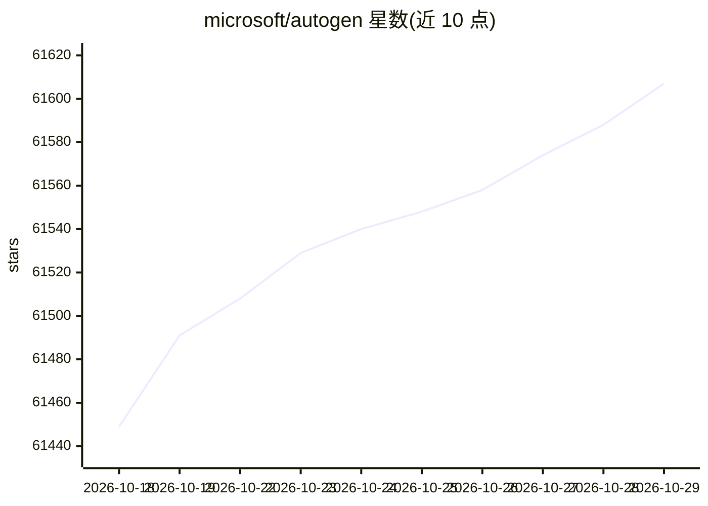

# microsoft/autogen

⭐ 61,607 · Python · CC-BY-4.0 · 推送 2026-10-28 · [GitHub](https://github.com/microsoft/autogen) · [官网](https://microsoft.github.io/autogen/) · 组织维护

**微软多智能体 AI 应用框架：构建可自主运行或与人协作的 agent 应用**

面向创建多智能体 AI 应用的 Python/.NET 框架，采用分层可扩展设计：Core API 提供消息传递、事件驱动 agent 与本地/分布式运行时，AgentChat 提供快速原型的高层 API，Extensions 提供模型客户端与代码执行等能力；配套 AutoGen Studio 无代码 GUI 与 AutoGen Bench 基准套件。注意：项目已被微软归档，不再提供 bug 修复、安全修复与新特性，新用户被引导至 Microsoft Agent Framework。

## 筛选速览

| 维度 | 判定 | 备注 |
|---|---|---|
| AI 角色 | `ai-native` | 本体是模型或模型工具 |
| 许可风险 | `viral` | CC-BY-4.0 |
| 部署形态 | `library` | 以包/库形式分发 |
| 模型依赖 | — | README 未给出锁定关系 |
| 硬件要求 | — | 无带数字的原话,不猜 |
| 安装摩擦 | `low` | 无编译、无系统依赖或容器化 |
| 成熟度 | — | 结构信号不足 |

## 动量与使用信号

- 维护:`active` — 距上次 push 1.6 天,年发版 0,443 位贡献者
- 涨星:近 1 天 **+9**(自 20261016 起算)
- 安装:npm 包 `@playwright/mcp` 月下载 29,573,181
- 平台:— · 协议:OPENAI-API / MCP

## 能力要点

- 分层框架：Core / AgentChat / Extensions 三层 API
- AutoGen Studio 无代码 GUI 构建多 agent 工作流
- 支持 MCP Server 接入与 AgentTool 多 agent 编排
- Core API 支持 .NET 与 Python 跨语言

## 适用场景

- 用无代码 GUI 快速原型多 agent 工作流
- 构建需要 web 浏览、代码执行、文件处理的多 agent 团队
- 历史项目维护与迁移评估（注意已归档）

## 场景标签

`Agent 框架` `多智能体` · 领域:Agent 开发

## 证据(README 行号)

> L11: **AutoGen** is a framework for creating multi-agent AI applications that can act autonomously or work alongside hum
> L108: The autogen _framework_ uses a layered and extensible design. Layers have clearly divided responsibilities and bui
> L14: > **⚠️ Project archived and no longer maintained**

## 星数曲线

2026-10-18 61,449 → 2026-10-29 61,607（+158）

---
*卡片 v1 · prompt 1.4 · 生成 2026-10-18 · 置信度 mid · 依据 README sha `d22ab0386054` · [字段定义](../../DATASET.md)*
