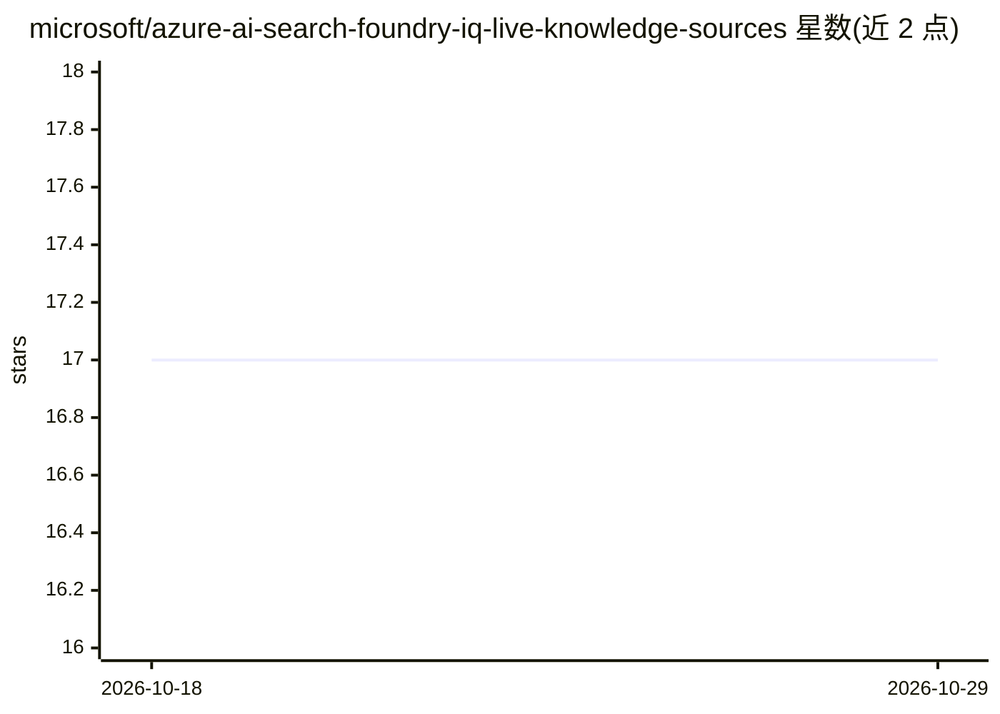

# microsoft/azure-ai-search-foundry-iq-live-knowledge-sources

⭐ 17 · Python · MIT · 推送 2026-10-26 · [GitHub](https://github.com/microsoft/azure-ai-search-foundry-iq-live-knowledge-sources) · [官网](https://microsoft.github.io/azure-ai-search-foundry-iq-live-knowledge-sources/) · 组织维护

**为 Azure 开发者部署 Foundry IQ 知识源的组合式加速器**

微软的可复用加速器（CLI `liveks`），面向已使用 Azure AI Search、Azure OpenAI 与 Microsoft Fabric 的实现者：将既有 Search 索引封装为 Foundry IQ Knowledge Source，组合预览版 MCP Server KS 与 Fabric Ontology KS，走 bootstrap→init→doctor→plan→up→verify 的守卫式生命周期。`./liveks try` 提供 30 秒离线回放（仅需 Python 3.11+，无 Azure 调用）；在线路径含 ARM preview 确认、BYO 资产保留与依赖序清理，并暴露原生 Knowledge Base MCP endpoint 供 MCP 客户端调用。声明自身非生产参考架构。

## 筛选速览

| 维度 | 判定 | 备注 |
|---|---|---|
| AI 角色 | `ai-ecosystem` | LLM/agent 周边工具 |
| 许可风险 | `permissive` | MIT |
| 部署形态 | `library` | 以包/库形式分发 |
| 模型依赖 | locked-api |  |
| 硬件要求 | — | 无带数字的原话,不猜 |
| 安装摩擦 | `low` | 无编译、无系统依赖或容器化 |
| 成熟度 | — | 结构信号不足 |

## 能力要点

- LiveKS CLI 覆盖 init/doctor/plan/up/verify/mcp/down 全生命周期
- 六种 profile 组合 Search Index / MCP Server / Fabric Ontology 知识源
- `./liveks try` 离线回放证据契约，Python 3.11+ 为唯一前置要求
- 输出原生 Knowledge Base MCP endpoint（knowledge_base_retrieve 工具）

## 适用场景

- 把既有 Azure AI Search 索引接入 Foundry IQ grounding
- 为 Foundry IQ 添加 Microsoft Learn MCP 与 Fabric Ontology 知识源
- 部署后用 verify 验证各来源独立检索与组合路由证据

## 场景标签

`RAG` · 领域:知识与检索

## 证据(README 行号)

> L27: |**Search implementer**|Wrap and prove an existing agentic-ready Search index without transferring ownership.|`sear
> L198: |**Foundry IQ Knowledge Base**|Plans retrieval across attached sources and produces one grounded result.|Answer co
> L199: |**Native Knowledge Base MCP endpoint**|Exposes `knowledge_base_retrieve` to MCP-compatible clients.|`tools/list`,

## 星数曲线

2026-10-18 17 → 2026-10-29 17（+0）

---
*卡片 v1 · prompt 1.4 · 生成 2026-10-29 · 置信度 mid · 依据 README sha `aef9d8a8efa3` · [字段定义](../../DATASET.md)*
