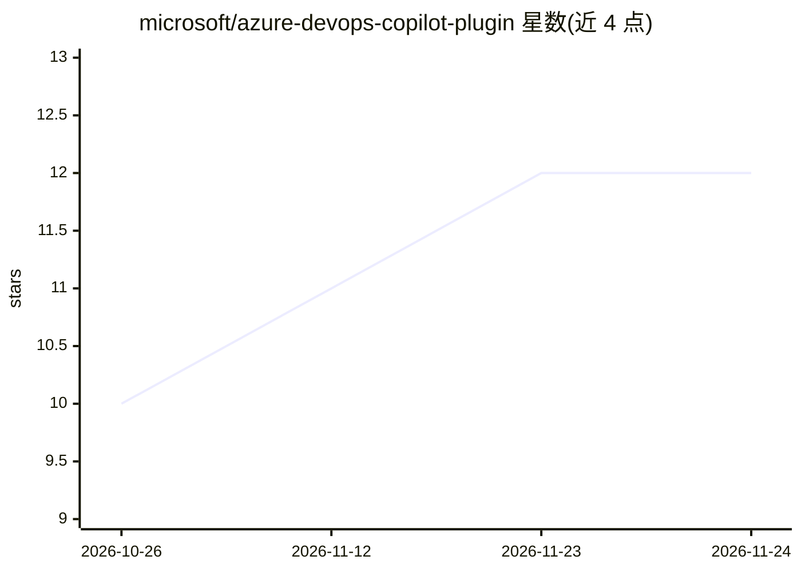

# microsoft/azure-devops-copilot-plugin

⭐ 12 · JavaScript · MIT · 推送 2026-11-05 · [GitHub](https://github.com/microsoft/azure-devops-copilot-plugin) · 组织维护

**让 GitHub Copilot App 中查看和操作 Azure DevOps 工作的插件**

面向 Azure DevOps 与 GitHub Copilot App 用户，将工作项、拉取请求与工作列表引入 Copilot 会话内，无需切换应用即可浏览与更新。提供交互式 Azure DevOps 画布，支持查看 My Work、管理工作项与 PR，并在 PR 与工作项之间建立关联。当前为预览版本，不支持生产工作负载且可能随时变更；通过添加 marketplace 仓库安装。

## 筛选速览

| 维度 | 判定 | 备注 |
|---|---|---|
| AI 角色 | `ai-enhanced` | 去掉 AI 部分产品仍成立 |
| 许可风险 | `permissive` | MIT |
| 部署形态 | `None` |  |
| 模型依赖 | — | README 未给出锁定关系 |
| 硬件要求 | — | 无带数字的原话,不猜 |
| 安装摩擦 | `low` | 无编译、无系统依赖或容器化 |
| 成熟度 | `idea` | |

## 能力要点

- 在 Copilot 会话内跨 Azure DevOps 查看 My Work
- 浏览与更新工作项、管理拉取请求
- PR 与工作项关联管理
- 交互式 Azure DevOps 画布

## 适用场景

- 在 GitHub Copilot App 中查看我的 Azure DevOps 待办
- 不切换应用直接评审和管理拉取请求
- 将 PR 与工作项进行关联

## 场景标签

`AI 助手` · 领域:对话与助手

## 证据(README 行号)

> L3: The Azure DevOps Copilot Plugin brings your Azure DevOps work into the GitHub Copilot App so you can review and act 
> L14: - Work through an interactive Azure DevOps canvas in the GitHub Copilot App.

## 星数曲线

2026-10-26 10 → 2026-11-24 12（+2）

---
*卡片 v1 · prompt 1.4 · 生成 2026-11-18 · 置信度 high · 依据 README sha `ceeb8f0996ae` · [字段定义](../../DATASET.md)*
