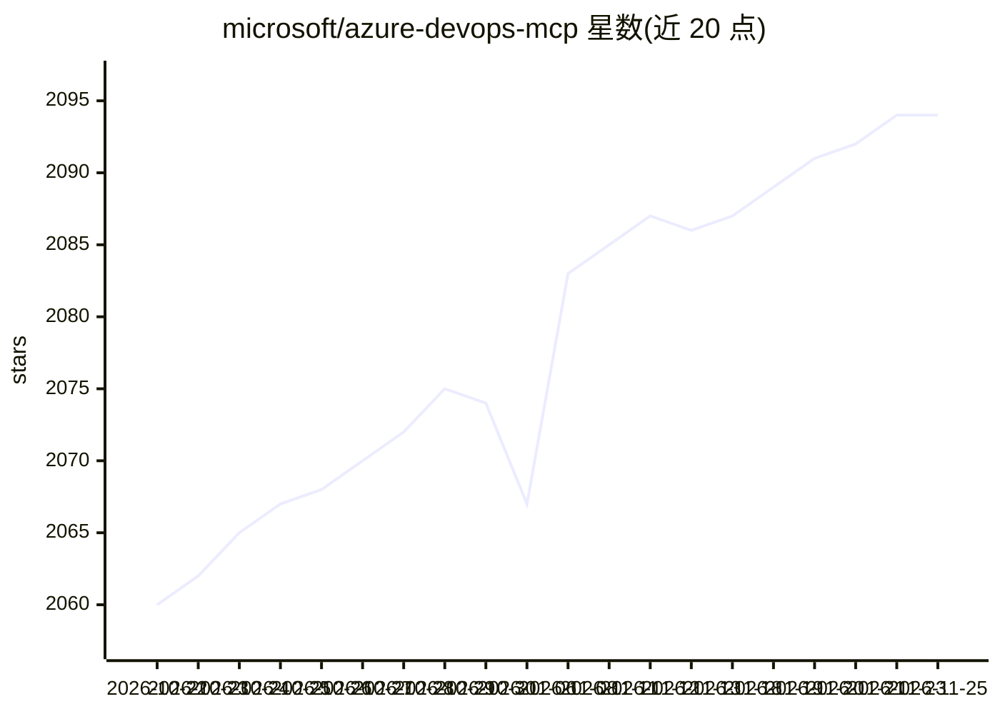

# microsoft/azure-devops-mcp

⭐ 2,094 · TypeScript · MIT · 推送 2026-11-21 · [GitHub](https://github.com/microsoft/azure-devops-mcp) · 组织维护

**让 AI agent 通过 MCP 访问 Azure DevOps 的服务器**

微软发布的 Azure DevOps MCP 服务器，通过 Model Context Protocol 将 Azure DevOps 的项目、工作项、代码仓库、构建流水线、测试计划、Wiki 等能力暴露给 AI agent。提供托管远程服务器（推荐）与本地 stdio 服务器两种运行方式；本地版按 core/work/pipelines 等 9 个领域加载工具以控制工具数量，需 Node.js 20 以上，经 npm 安装并在 VS Code 等客户端中配置。

## 筛选速览

| 维度 | 判定 | 备注 |
|---|---|---|
| AI 角色 | `ai-ecosystem` | LLM/agent 周边工具 |
| 许可风险 | `permissive` | MIT |
| 部署形态 | `None` |  |
| 模型依赖 | — | README 未给出锁定关系 |
| 硬件要求 | — | 无带数字的原话,不猜 |
| 安装摩擦 | `low` | 无编译、无系统依赖或容器化 |
| 成熟度 | — | 结构信号不足 |

## 能力要点

- 通过 MCP 为 AI agent 提供 Azure DevOps REST API 的工具层
- 提供托管远程服务器与本地 stdio 两种运行方式
- 本地版支持 9 个领域（domains）按需加载工具组
- 支持 npm 安装与 nightly 构建版本（@next）

## 适用场景

- 在 VS Code Copilot Agent 模式下用自然语言查询项目、工作项与构建
- 让 agent 读取和更新 Wiki 页面
- 管理迭代与测试计划等工作项流程
- 仅在需要本地 stdio 连接时运行本地服务器

## 场景标签

 · 领域:开发者工具/DevOps

## 证据(README 行号)

> L8: This project gives AI agents access to Azure DevOps through the Model Context Protocol (MCP). Use the hosted remote 
> L31: Each tool handles a focused Azure DevOps task. The server provides a thin layer over the REST APIs, while the AI ag
> L37: The remote server will eventually replace the local server. The local server remains supported, but new development

## 星数曲线

2026-10-22 2,060 → 2026-11-25 2,094（+34）

---
*卡片 v1 · prompt 1.4 · 生成 2026-11-24 · 置信度 high · 依据 README sha `0702c5182ef4` · [字段定义](../../DATASET.md)*
