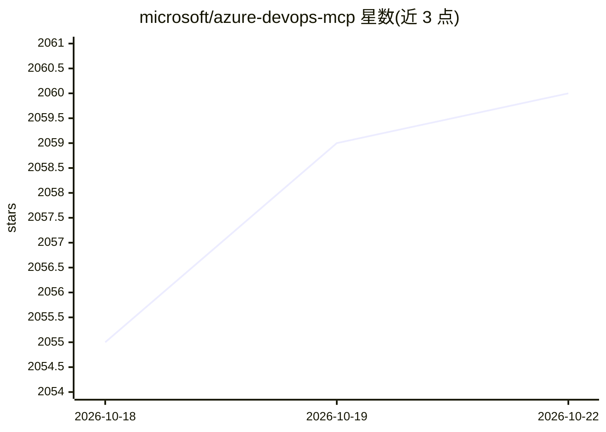

# microsoft/azure-devops-mcp

⭐ 2,062 · TypeScript · MIT · 推送 2026-10-22 · [GitHub](https://github.com/microsoft/azure-devops-mcp) · 组织维护

**让 AI agent 通过 MCP 访问 Azure DevOps 的服务器**

微软维护的 MCP 服务器，通过 Model Context Protocol 让 AI agent 操作 Azure DevOps：列出项目、构建、仓库、工作项、测试计划、迭代、wiki，并支持创建和更新 wiki 页面。提供托管远程服务器（推荐，无需安装）与本地 stdio 服务器两种形态；本地服务器通过 npm 包 @azure-devops/mcp 运行，需 Node.js 20+，支持按域（core/work/pipelines 等）加载工具组。README 声明远程服务器未来将取代本地服务器，建议现有用户规划迁移。

## 筛选速览

| 维度 | 判定 | 备注 |
|---|---|---|
| AI 角色 | `ai-ecosystem` | LLM/agent 周边工具 |
| 许可风险 | `permissive` | MIT |
| 部署形态 | `None` |  |
| 模型依赖 | — | README 未给出锁定关系 |
| 硬件要求 | — | 无带数字的原话,不猜 |
| 安装摩擦 | `low` | 无编译、无系统依赖或容器化 |
| 成熟度 | — | 结构信号不足 |

## 能力要点

- 提供远程托管与本地 stdio 两种 MCP 服务器形态
- 覆盖工作项、仓库、管道、测试计划、wiki 等 Azure DevOps 操作
- 本地服务器支持按域（9 个域）加载工具组以适配工具数量限制
- 兼容 VS Code、Visual Studio 2022、Claude Code、Cursor 等多种 MCP 客户端

## 适用场景

- 在 VS Code 中用 Copilot Agent 模式查询和管理 Azure DevOps 工作项
- 让 AI agent 读写项目 wiki 页面
- 通过 stdio 本地连接在受限环境中接入 Azure DevOps

## 场景标签

 · 领域:开发运维/DevOps 工具集成

## 证据(README 行号)

> L8: This project gives AI agents access to Azure DevOps through the Model Context Protocol (MCP). Use the hosted remote 
> L31: Each tool handles a focused Azure DevOps task. The server provides a thin layer over the REST APIs, while the AI ag

## 星数曲线

2026-10-18 2,055 → 2026-10-22 2,060（+5）

---
*卡片 v1 · prompt 1.4 · 生成 2026-10-21 · 置信度 high · 依据 README sha `9659381ba16b` · [字段定义](../../DATASET.md)*
