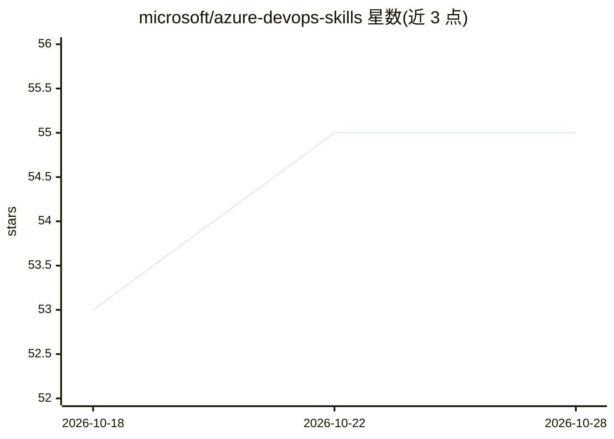

# microsoft/azure-devops-skills

⭐ 55 · MIT · 推送 2026-07-16 · [GitHub](https://github.com/microsoft/azure-devops-skills) · 组织维护

**Azure DevOps 的 AI 编程助手技能示例集（7 个技能）**

微软维护的可复用技能（SKILL.md）示例仓库，教 GitHub Copilot 等 AI 编程助手通过 Azure DevOps MCP Server 以一致、可重复的方式执行 DevOps 任务。现有技能覆盖看板工作项查询与汇总、积压工作梳理、迭代创建与分配、流水线构建排查、高级安全告警审查。每个技能定义触发时机、可调用的 MCP 工具与工作流边界；另提供新技能模板与贡献指南。需在 VS Code 中配合已配置认证的 Azure DevOps MCP server 使用。

## 筛选速览

| 维度 | 判定 | 备注 |
|---|---|---|
| AI 角色 | `ai-knowledge` | 知识聚合/清单类 |
| 许可风险 | `permissive` | MIT |
| 部署形态 | `None` |  |
| 模型依赖 | — | README 未给出锁定关系 |
| 硬件要求 | — | 无带数字的原话,不猜 |
| 安装摩擦 | `low` | 无编译、无系统依赖或容器化 |
| 成熟度 | `idea` | |

## 能力要点

- 7 个技能覆盖看板、迭代、流水线与安全告警场景
- 每个技能含 SKILL.md：触发条件、可调 MCP 工具、工作流与边界情况
- 提供新技能创建模板与贡献规范
- 自述项目尚新、技能数量有限（L20）

## 适用场景

- 让 Copilot 在 VS Code 中按规范执行 Azure DevOps 查询与操作
- 作为编写自定义 DevOps agent 技能的参考模板
- 减少向 AI 助手重复解释组织/项目级约定

## 场景标签

 · 领域:开发运维/agent 技能

## 证据(README 行号)

> L3: This repository contains examples of reusable "skills" for working with Azure DevOps from AI coding assistants (for 
> L39: These skills are intended to be used with GitHub Copilot in VS Code and an Azure DevOps Model Context Protocol (MCP

## 星数曲线

2026-10-18 53 → 2026-10-28 55（+2）

---
*卡片 v1 · prompt 1.4 · 生成 2026-10-24 · 置信度 high · 依据 README sha `ee5189a372a9` · [字段定义](../../DATASET.md)*
