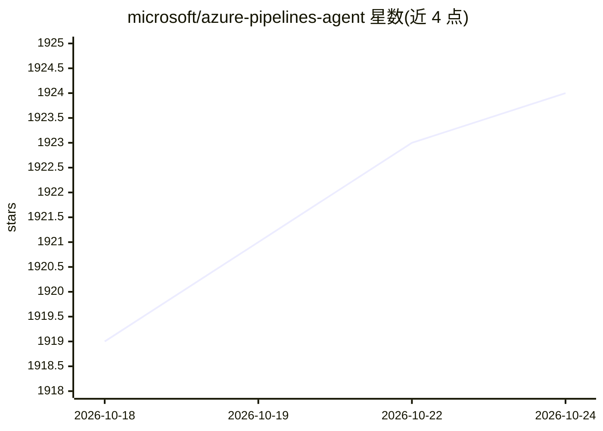

# microsoft/azure-pipelines-agent

⭐ 1,924 · C# · MIT · 推送 2026-10-23 · [GitHub](https://github.com/microsoft/azure-pipelines-agent) · 组织维护

**微软出品的 Azure Pipelines 跨平台 CI/CD 构建代理**

Azure Pipelines 与 Team Foundation Server/Azure DevOps Server 使用的跨平台构建与发布代理，用 C# 基于 .NET Core 编写，支持 Windows（x64/x86/ARM64）、macOS 与多种 Linux 发行版。以预编译发布包形式提供，含 Latest 与 Pre-release 两种发布标签，分批向用户推出（约 6-8 天全量）。README 同时公告因迁移到 .NET 6，AZP_AGENT_USE_LEGACY_HTTP 遗留 HTTP 旋钮将在迁移后失效。

## 筛选速览

| 维度 | 判定 | 备注 |
|---|---|---|
| AI 角色 | `ai-enhanced` | 去掉 AI 部分产品仍成立 |
| 许可风险 | `permissive` | MIT |
| 部署形态 | `None` |  |
| 模型依赖 | — | README 未给出锁定关系 |
| 硬件要求 | — | 无带数字的原话,不猜 |
| 安装摩擦 | `medium` | 含编译或系统依赖之一 |
| 成熟度 | — | 结构信号不足 |

## 能力要点

- 跨平台支持 Windows/macOS/Linux 多架构（含 ARM/ARM64）
- 服务 Azure Pipelines 与 Azure DevOps Server（TFS 2015+）
- 发布标签 Latest / Pre-release 分批推送机制

## 适用场景

- 在自管机器上运行 Azure Pipelines 构建任务
- 企业内为 Azure DevOps Server 搭建本地构建代理
- 在 ARM 架构设备上运行 CI 代理

## 场景标签

 · 领域:DevOps/CI-CD 工具

## 证据(README 行号)

> L11: The cross-platform build and release agent for Azure Pipelines and Team Foundation Server 2015 and beyond.
> L35: This agent can be used for both Azure Pipelines and Azure DevOps Server (Team Foundation Server).

## 星数曲线

2026-10-18 1,919 → 2026-10-24 1,924（+5）

---
*卡片 v1 · prompt 1.4 · 生成 2026-10-21 · 置信度 low · 依据 README sha `be87db51ee7c` · [字段定义](../../DATASET.md)*
