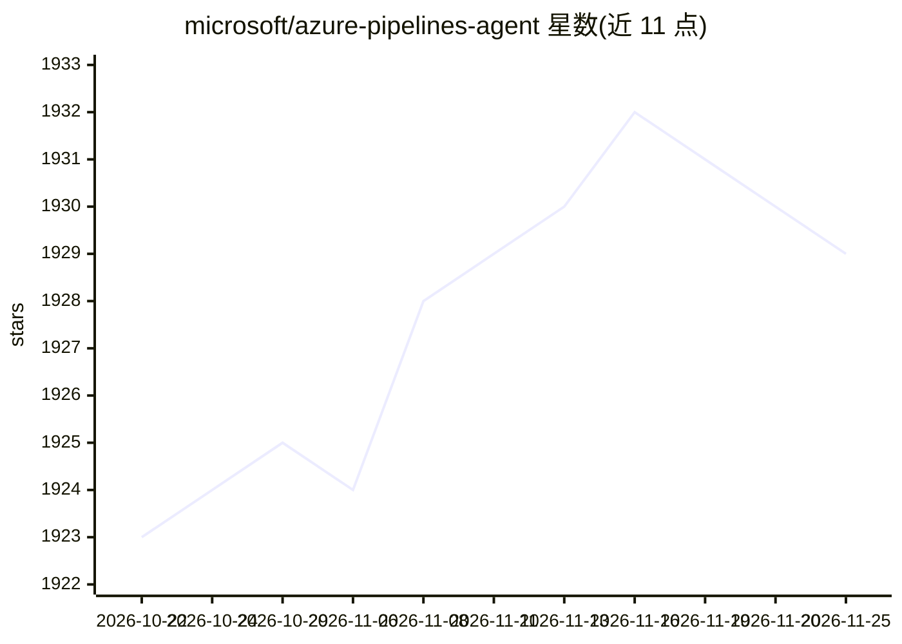

# microsoft/azure-pipelines-agent

⭐ 1,929 · C# · MIT · 推送 2026-11-23 · [GitHub](https://github.com/microsoft/azure-pipelines-agent) · 组织维护

**Azure Pipelines 与 TFS 的跨平台构建发布代理**

微软维护的 Azure Pipelines 与 Azure DevOps Server（TFS 2015 及以上）所使用的跨平台构建与发布代理，以 C# / .NET Core 编写，运行于 Windows、macOS 及多种 Linux 发行版（x64/x86/ARM 架构），用于在目标机器上执行流水线任务。README 未含安装命令，安装入口指向外部入门文档；当前版本正在移除捆绑的旧版 Node.js 任务运行器，需要旧运行器的任务需迁移。

## 筛选速览

| 维度 | 判定 | 备注 |
|---|---|---|
| AI 角色 | `ai-enhanced` | 去掉 AI 部分产品仍成立 |
| 许可风险 | `permissive` | MIT |
| 部署形态 | `None` |  |
| 模型依赖 | — | README 未给出锁定关系 |
| 硬件要求 | — | 无带数字的原话,不猜 |
| 安装摩擦 | `low` | 无编译、无系统依赖或容器化 |
| 成熟度 | — | 结构信号不足 |

## 能力要点

- 跨平台构建与发布代理，支持 Windows/macOS/Linux 多架构
- 支持 Azure Pipelines 与 Azure DevOps Server（TFS 2015+）
- 以 C# / .NET Core 编写
- 公告将移除 Node.js 6/10/16 及 pipelines-agent 中的 Node.js 20 运行器

## 适用场景

- 在自托管机器上为 Azure Pipelines 执行 CI/CD 任务
- 为本地部署的 Azure DevOps Server / TFS 提供构建代理
- 为多平台（含 ARM）流水线提供运行节点

## 场景标签

 · 领域:软件开发/持续集成

## 证据(README 行号)

> L17: The cross-platform build and release agent for Azure Pipelines and Team Foundation Server 2015 and beyond.
> L20: Supported on Windows, macOS, and several Linux flavors.
> L21: Written for .NET Core in C#.

## 星数曲线

2026-10-22 1,923 → 2026-11-25 1,929（+6）

---
*卡片 v1 · prompt 1.4 · 生成 2026-11-23 · 置信度 high · 依据 README sha `422542ddf599` · [字段定义](../../DATASET.md)*
