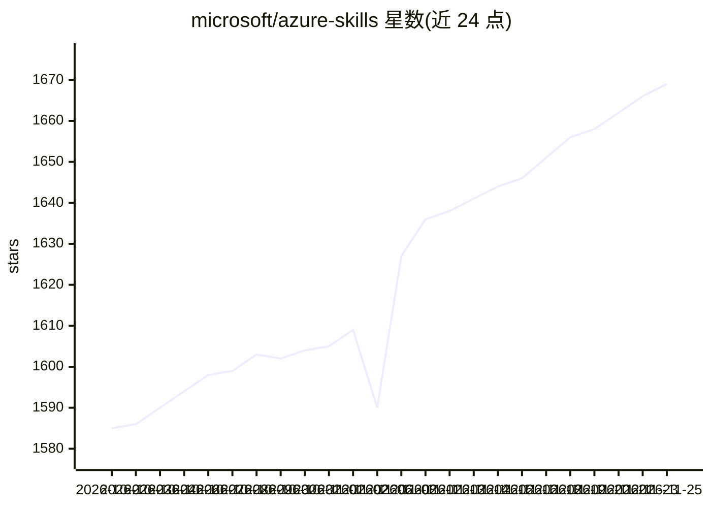

# microsoft/azure-skills

⭐ 1,669 · JavaScript · MIT · 推送 2026-11-20 · [GitHub](https://github.com/microsoft/azure-skills) · 组织维护

**为编码 Agent 提供 Azure 技能与 MCP 服务器配置的插件**

微软官方发布的 Agent 插件，包含三层内容：Azure 技能层（azure-prepare/azure-deploy/azure-diagnostics/azure-cost 等，提供工作流、决策树与守则）、Azure MCP Server（覆盖 40+ Azure 服务的 200+ 结构化工具）以及面向 Microsoft Foundry 场景的 Foundry MCP。插件支持多宿主安装，包括 GitHub Copilot CLI、VS Code、Claude Code、Gemini CLI、Cursor、Codex CLI 与 IntelliJ IDEA，并提供主权云（Azure 中国/美国政府云）配置说明。安装前提包括 Node.js 18+、Azure CLI 及 azd 认证。

## 筛选速览

| 维度 | 判定 | 备注 |
|---|---|---|
| AI 角色 | `ai-ecosystem` | LLM/agent 周边工具 |
| 许可风险 | `permissive` | MIT |
| 部署形态 | `library` | 以包/库形式分发 |
| 模型依赖 | — | README 未给出锁定关系 |
| 硬件要求 | — | 无带数字的原话,不猜 |
| 安装摩擦 | `low` | 无编译、无系统依赖或容器化 |
| 成熟度 | — | 结构信号不足 |

## 能力要点

- 打包 200+ Azure 技能与 Azure MCP Server 的 200+ 结构化工具
- 多宿主支持：Copilot、Claude Code、Cursor、Gemini CLI、Codex、IntelliJ
- 包含 Foundry MCP 用于模型发现、部署与 Agent 工作流
- 提供主权云（Azure China Cloud / US Government）配置路径

## 适用场景

- 让编码 Agent 执行真实的 Azure 部署、验证与诊断操作
- 查询 Azure 资源、价格、日志与配额等实时信息
- 在 Microsoft Foundry 中进行模型发现与部署
- 为 Azure 中国云或美国政府云环境配置 Agent 工具链

## 场景标签

`编码 Agent` · 领域:编码与开发

## 证据(README 行号)

> L3: Azure work is not just a code problem. It is a decision problem: which service fits this app, what needs to be valid
> L23: The plugin wires in the **Azure MCP Server**, which gives your agent **200+ structured tools across 40+ Azure servi
> L36: - **Multi-host support** lets you use the same Azure capability across environments such as GitHub Copilot in VS Co

## 星数曲线

2026-10-22 1,585 → 2026-11-25 1,669（+84）

---
*卡片 v1 · prompt 1.4 · 生成 2026-11-23 · 置信度 high · 依据 README sha `ab45abee2832` · [字段定义](../../DATASET.md)*
