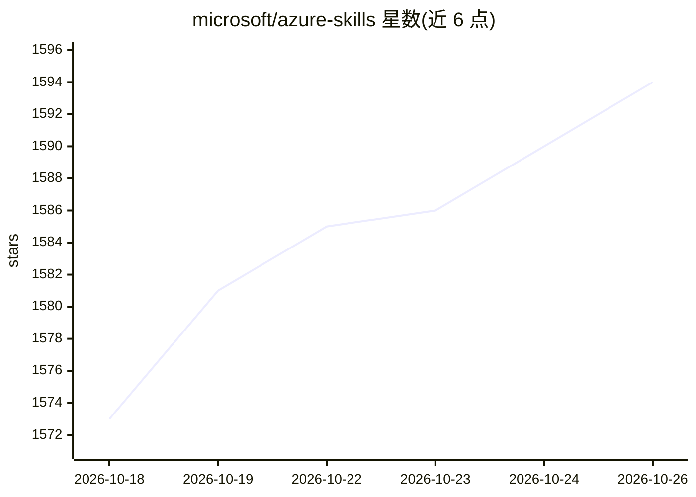

# microsoft/azure-skills

⭐ 1,594 · Shell · MIT · 推送 2026-10-23 · [GitHub](https://github.com/microsoft/azure-skills) · 组织维护 · 中文 README

**微软官方 Azure 技能插件：给编码 agent 提供 Azure 知识与 MCP 工具**

面向兼容编码 agent 的插件包，由三层组成：策展的 Azure 技能（准备/验证/部署/诊断/成本/RBAC 等工作流与守则）、Azure MCP Server（覆盖 40+ Azure 服务的 200+ 结构化工具）以及面向 Microsoft Foundry 的 Foundry MCP。支持通过 APM、GitHub Copilot CLI、VS Code、Claude Code、Gemini CLI、Cursor、Codex、IntelliJ IDEA 等多种宿主安装，另支持 Azure China Cloud 与 Azure US Government 主权云配置。前置要求包括 Azure 订阅、Node.js 18+、Azure CLI 登录。

## 筛选速览

| 维度 | 判定 | 备注 |
|---|---|---|
| AI 角色 | `ai-ecosystem` | LLM/agent 周边工具 |
| 许可风险 | `permissive` | MIT |
| 部署形态 | `library` | 以包/库形式分发 |
| 模型依赖 | — | README 未给出锁定关系 |
| 硬件要求 | — | 无带数字的原话,不猜 |
| 安装摩擦 | `low` | 无编译、无系统依赖或容器化 |
| 成熟度 | — | 结构信号不足 |

## 能力要点

- 三层能力：Azure 技能 + Azure MCP Server（200+ 工具/40+ 服务）+ Foundry MCP
- 多宿主支持：Copilot CLI/VS Code/Claude Code/Gemini CLI/Cursor/Codex/IntelliJ
- APM 单命令跨环境安装（apm install）
- 主权云（Azure China / US Government）配置支持

## 适用场景

- 让编码 agent 按 Azure 工作流准备、验证并部署应用
- 通过对话查询 Azure 资源、成本与诊断信息
- 在 agent 内完成 Microsoft Foundry 模型发现与部署
- 国内 Azure China Cloud 环境下接入 agent 工具链

## 场景标签

 · 领域:云开发/AI agent 工具

## 证据(README 行号)

> L3: Azure work is not just a code problem. It is a decision problem: which service fits this app, what needs to be valid
> L23: The plugin wires in the **Azure MCP Server**, which gives your agent **200+ structured tools across 40+ Azure servi
> L36: - **Multi-host support** lets you use the same Azure capability across environments such as GitHub Copilot in VS Co

## 星数曲线

2026-10-18 1,573 → 2026-10-26 1,594（+21）

---
*卡片 v1 · prompt 1.4 · 生成 2026-10-21 · 置信度 high · 依据 README sha `62cd67dd24a2` · [字段定义](../../DATASET.md)*
