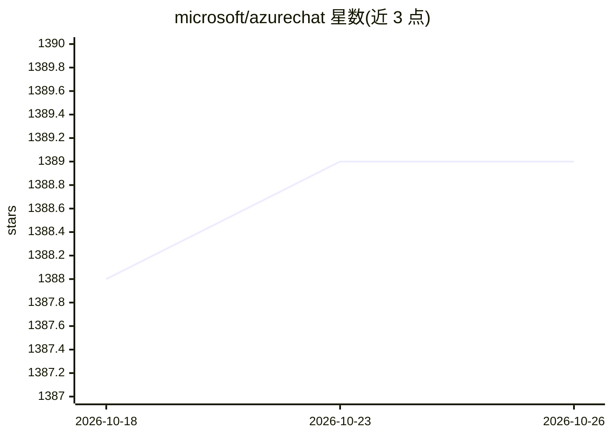

# microsoft/azurechat

⭐ 1,389 · TypeScript · MIT · 推送 2026-10-14 · [GitHub](https://github.com/microsoft/azurechat) · 组织维护

**企业在其 Azure 订阅内部署私有 ChatGPT 式聊天服务的方案加速器**

Microsoft 维护的解决方案加速器：基于 Azure OpenAI Service，让组织在自己的 Azure 订阅中部署私有聊天租户，支持对内部数据与文件进行对话，并可与内部服务（如 ServiceNow）集成。2025 年更新加入托管标识安全（基于 Azure RBAC、移除几乎全部密钥/机密）、Entra ID 应用注册辅助脚本、私有终结点与 ESLR 合规部署支持。部署途径为 Azure Developer CLI（azd up）或 Azure Portal 部署按钮，需另行配置身份提供者与管理员用户。

## 筛选速览

| 维度 | 判定 | 备注 |
|---|---|---|
| AI 角色 | `ai-native` | 本体是模型或模型工具 |
| 许可风险 | `permissive` | MIT |
| 部署形态 | `None` |  |
| 模型依赖 | locked-api |  |
| 硬件要求 | — | 无带数字的原话,不猜 |
| 安装摩擦 | `low` | 无编译、无系统依赖或容器化 |
| 成熟度 | — | 结构信号不足 |

## 能力要点

- 基于 Azure OpenAI 的私有聊天租户部署
- 托管标识安全与 Entra ID 应用注册辅助脚本
- 支持私有终结点与 ESLZ 合规部署
- 可接入内部数据源与内部服务（如 ServiceNow）

## 适用场景

- 企业在自有 Azure 订阅内部署私有 AI 聊天服务
- 让员工基于内部数据与文件进行对话问答
- 通过 GitHub Actions 自动化部署到 Azure

## 场景标签

`聊天机器人` `文档问答` · 领域:对话与助手

## 证据(README 行号)

> L26: _Azure Chat Solution Accelerator powered by Azure OpenAI Service_
> L30: _Azure Chat Solution Accelerator powered by Azure OpenAI Service_ is a solution accelerator that allows organisatio

## 星数曲线

2026-10-18 1,388 → 2026-10-26 1,389（+1）

---
*卡片 v1 · prompt 1.4 · 生成 2026-10-21 · 置信度 high · 依据 README sha `af9f6f708469` · [字段定义](../../DATASET.md)*
