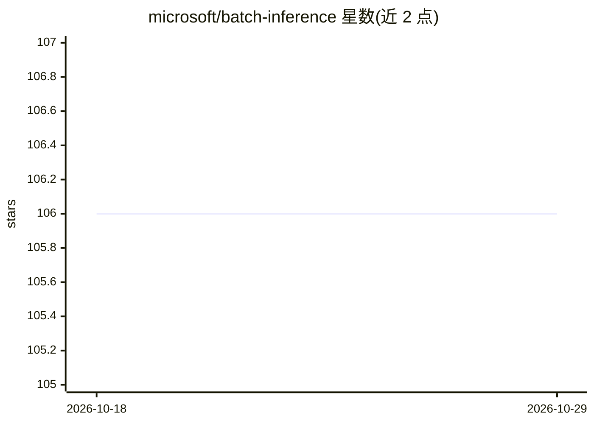

# microsoft/batch-inference

⭐ 106 · Python · MIT · 推送 2026-08-24 · [GitHub](https://github.com/microsoft/batch-inference) · [官网](https://microsoft.github.io/batch-inference/) · 组织维护

**深度学习推理的动态批处理库，提升服务吞吐量**

微软开源的 Python 库：将来自多个请求的模型输入张量动态合批，执行模型后拆分输出返回各请求，过程对开发者透明。使用方式为在模型类定义 predict_batch 方法并添加 batching 装饰器，通过 ModelHost.predict 接收单条查询自动合批。提供内置批处理算法（如 ConcatBatcher），支持自定义 Batcher 与多进程远程模式以规避 Python GIL 限制。README 给出 Bert Embedding 4.7x、GPT Completion 16x 的吞吐对比数据与教程链接。面向在云端 GPU 服务器托管模型推理的开发者。

## 筛选速览

| 维度 | 判定 | 备注 |
|---|---|---|
| AI 角色 | `ai-ecosystem` | LLM/agent 周边工具 |
| 许可风险 | `permissive` | MIT |
| 部署形态 | `library` | 以包/库形式分发 |
| 模型依赖 | — | README 未给出锁定关系 |
| 硬件要求 | — | 无带数字的原话,不猜 |
| 安装摩擦 | `low` | 无编译、无系统依赖或容器化 |
| 成熟度 | — | 结构信号不足 |

## 能力要点

- 请求级动态合批与输出拆分，对开发者透明
- 内置批处理算法，几行代码即可接入，支持自定义 Batcher
- 多进程远程模式规避 Python GIL 限制
- 平台无关的轻量 Python 库，附热门模型教程与基准

## 适用场景

- 云端 GPU 服务器上托管深度学习模型推理时提升吞吐
- GPT/Bert 等模型服务需要动态批处理降低延迟与成本
- 希望以少量代码改造为现有模型类加批处理能力

## 场景标签

`推理引擎` · 领域:训练与推理

## 证据(README 行号)

> L3: Batch Inference Toolkit(batch-inference) is a Python package that batches model input tensors coming from multiple r
> L7: When you want to host Deep Learning model inference on Cloud servers, especially on GPU
> L45: Let's start with a toy model to learn the APIs. Firstly, you need to define a **predict_batch** method in your mode

## 星数曲线

2026-10-18 106 → 2026-10-29 106（+0）

---
*卡片 v1 · prompt 1.4 · 生成 2026-10-23 · 置信度 high · 依据 README sha `4634163128d3` · [字段定义](../../DATASET.md)*
