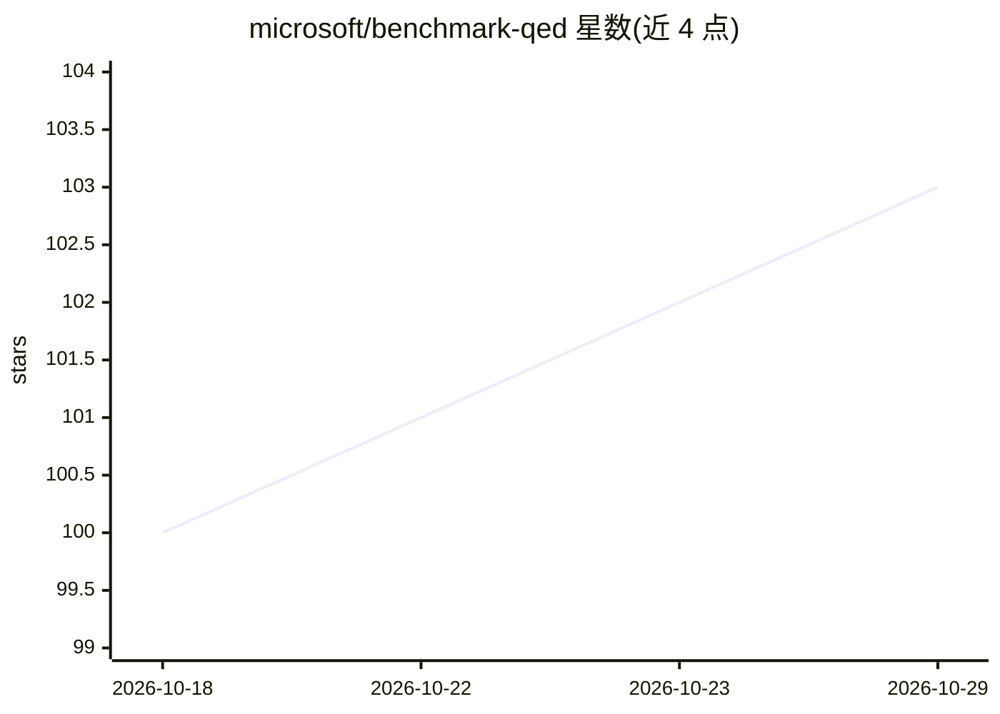

# microsoft/benchmark-qed

⭐ 103 · Python · MIT · 推送 2026-10-26 · [GitHub](https://github.com/microsoft/benchmark-qed) · [官网](https://microsoft.github.io/benchmark-qed/) · 组织维护

**微软开源的 RAG 系统自动化基准评测工具套件**

由 Microsoft 维护的 RAG 系统自动化基准评测套件，包含三个组件：AutoQ 用 LLM 合成从局部到全局的合成查询（含多跳数据关联查询）以保证可复现测试；AutoE 以 LLM-as-a-Judge 方式在相关性、全面性、多样性等指标上对比评测 RAG 回答，支持断言式打分与有真值时的正确性评估；AutoD 提供数据集采样与摘要工具。另发布两个评测数据集（Podcast Transcripts 70 集、AP News 1,397 篇健康新闻）。面向需要规模化评测 RAG 系统的研究者与开发者，以 Python 包形式发布在 PyPI。

## 筛选速览

| 维度 | 判定 | 备注 |
|---|---|---|
| AI 角色 | `ai-ecosystem` | LLM/agent 周边工具 |
| 许可风险 | `permissive` | MIT |
| 部署形态 | `library` | 以包/库形式分发 |
| 模型依赖 | — | README 未给出锁定关系 |
| 硬件要求 | — | 无带数字的原话,不猜 |
| 安装摩擦 | `low` | 无编译、无系统依赖或容器化 |
| 成熟度 | — | 结构信号不足 |

## 能力要点

- AutoQ 用 LLM 合成局部到全局范围的合成查询，含多跳数据关联查询
- AutoE 采用 LLM-as-a-Judge 对比回答的相关性/全面性/多样性/赋能性等指标
- AutoE 支持断言式打分（人工编写或 AutoQ 生成）
- 随套件发布 Podcast Transcripts 与 AP News 两个评测数据集

## 适用场景

- 为自研 RAG 系统生成可复现的评测查询集
- 规模化对比不同 RAG 系统回答质量
- 为查询合成准备结构一致的输入数据集

## 场景标签

`模型评测` · 领域:评测与运维

## 证据(README 行号)

> L25: BenchmarkQED is a suite of tools designed for automated benchmarking of retrieval-augmented generation (RAG) system
> L27: - **AutoQ:** Generates synthetic queries with variable data scope, ranging from local queries (answered using a sma
> L28: - **AutoE:** Evaluates RAG answers by comparing them side-by-side on key metrics—relevance, comprehensiveness, dive

## 星数曲线

2026-10-18 100 → 2026-10-29 103（+3）

---
*卡片 v1 · prompt 1.4 · 生成 2026-10-23 · 置信度 high · 依据 README sha `eaafba1fd7f1` · [字段定义](../../DATASET.md)*
