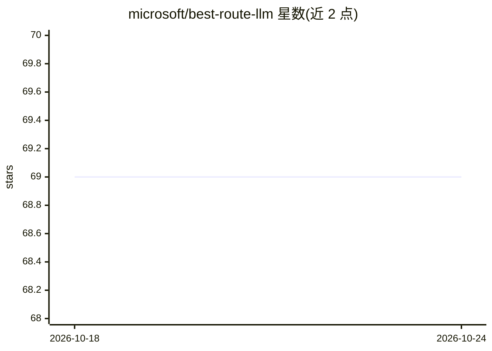

# microsoft/best-route-llm

⭐ 70 · Python · MIT · 推送 2026-10-19 · [GitHub](https://github.com/microsoft/best-route-llm) · 组织维护

**面向研究者的 LLM 查询路由训练代码：按难度选模型与采样数**

微软研究院发布的论文配套代码库，包含 Hybrid LLM（ICLR 2024）与 BEST-Route（ICML 2025）两项 LLM 路由工作。流程为：混合多数据集提示、对每个候选模型多次采样回答、用 armoRM 打分做成本建模、训练代理奖励模型（基于 DeBERTa），再用 train_router.py 训练在候选模型与 best-of-n 采样数之间做选择的路由器。要求 Python>=3.9、PyTorch>=2.6.0，无打包发布，面向复现实验的研究者。

## 筛选速览

| 维度 | 判定 | 备注 |
|---|---|---|
| AI 角色 | `ai-ecosystem` | LLM/agent 周边工具 |
| 许可风险 | `permissive` | MIT |
| 部署形态 | `library` | 以包/库形式分发 |
| 模型依赖 | — | README 未给出锁定关系 |
| 硬件要求 | — | 无带数字的原话,不猜 |
| 安装摩擦 | `low` | 无编译、无系统依赖或容器化 |
| 成熟度 | — | 结构信号不足 |

## 能力要点

- BEST-Route 同时选择模型与回答采样数（best-of-n）
- 完整流水线：数据混合→多模型采样→armoRM 打分→成本建模→奖励模型训练→路由器训练
- 支持确定性（det_2cls）与概率（prob_2cls）两类路由器训练
- 检查点以 weights_only=True 安全加载，拒绝非白名单 pickle 对象

## 适用场景

- 复现 Hybrid LLM / BEST-Route 论文实验
- 在自己的模型组合上训练成本感知的查询路由器
- 研究 best-of-n 采样与路由的性能-成本权衡

## 场景标签

`微调` · 领域:训练与推理

## 证据(README 行号)

> L7: This repository contains the code for our work on LLM routing strategies, including:
> L19: In **BEST-Route**, we aim to push envelope on the performance-cost trade-offs achieved by routing queries to small 
> L111: 2. Train **BEST-Route** routers

## 星数曲线

2026-10-18 69 → 2026-10-24 69（+0）

---
*卡片 v1 · prompt 1.4 · 生成 2026-10-24 · 置信度 high · 依据 README sha `c7ce0a1764f1` · [字段定义](../../DATASET.md)*
