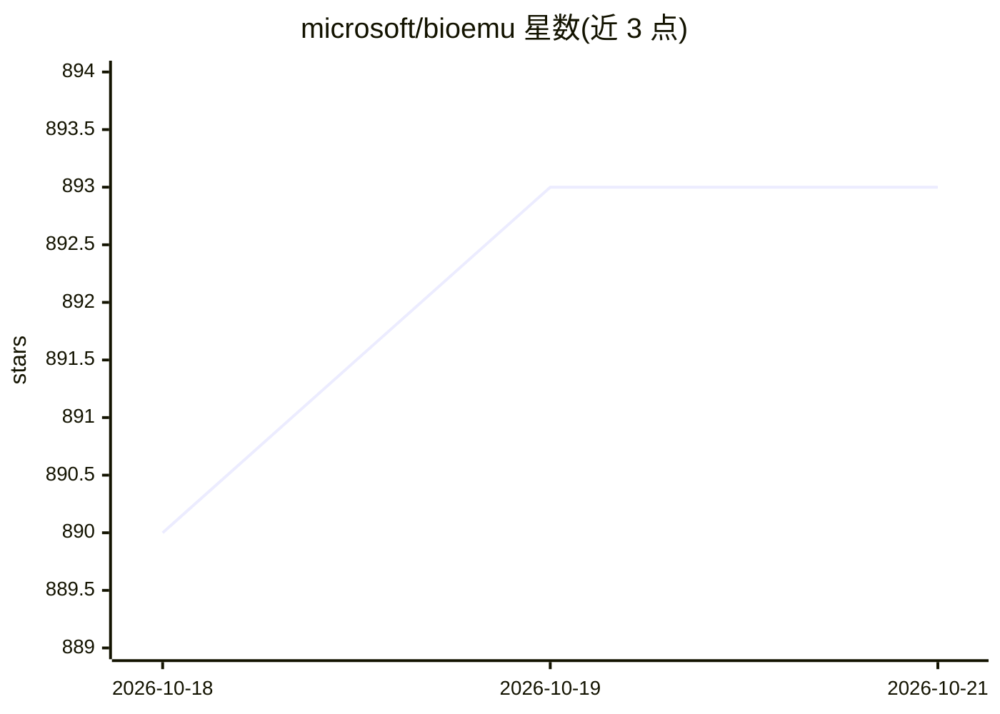

# microsoft/bioemu

⭐ — · [GitHub]() · 组织维护

**蛋白质平衡系综采样的生成式深度学习模型推理代码**

BioEmu 是微软发布的蛋白质单体平衡结构系综仿真模型：给定氨基酸序列，从近似的平衡分布中采样蛋白质构象。仓库提供推理代码与模型权重，以 Linux-only 的 pip 包分发，内置 ColabFold/AlphaFold2 用于 MSA 检索与嵌入生成。提供 CLI 与 Python API 采样，默认过滤非物理结构（原子冲突/链断裂），并带 SMC 与 FKC 两种物理引导算法。可选安装 HPacker 侧链重建与 MD 弛豫（需 conda，核心采样不需要）。仅支持单体采样，多聚体效果有限；另有 bioemu-v1.0/1.1/1.2 三个 checkpoint。亦可在 Azure AI Foundry 上运行。

## 筛选速览

| 维度 | 判定 | 备注 |
|---|---|---|
| AI 角色 | `ai-native` | 本体是模型或模型工具 |
| 许可风险 | `permissive` | — |
| 部署形态 | `library` | 以包/库形式分发 |
| 模型依赖 | — | README 未给出锁定关系 |
| 硬件要求 | — | 无带数字的原话,不猜 |
| 安装摩擦 | `medium` | 含编译或系统依赖之一 |
| 成熟度 | — | 结构信号不足 |

## 能力要点

- 给定氨基酸序列生成蛋白质平衡构象系综样本
- SMC 与 FKC 两种物理引导算法，减少非物理结构
- 内置 ColabFold/AlphaFold2 做 MSA 检索，无需单独安装
- 可选侧链重建与 MD 弛豫后处理（HPacker 接口）

## 适用场景

- 为一条蛋白质序列快速采样大量平衡构象
- 替代部分分子动力学模拟做蛋白质折叠自由能研究
- 复现论文结果或使用不同 checkpoint 做对比

## 场景标签

 · 领域:计算生物学/蛋白质科学

## 证据(README 行号)

> L8: Biomolecular Emulator (BioEmu for short) is a model that samples from the approximated equilibrium distribution of s
> L12: This repository contains inference code and model weights.
> L128: - [Default] The `bioemu-v1.1` checkpoint contains the model weights used to produce the results in the published S

## 星数曲线

2026-10-18 890 → 2026-10-21 893（+3）

---
*卡片 v1 · prompt 1.4 · 生成 2026-10-21 · 置信度 high · 依据 README sha `d88bca0cc1f3` · [字段定义](../../DATASET.md)*
