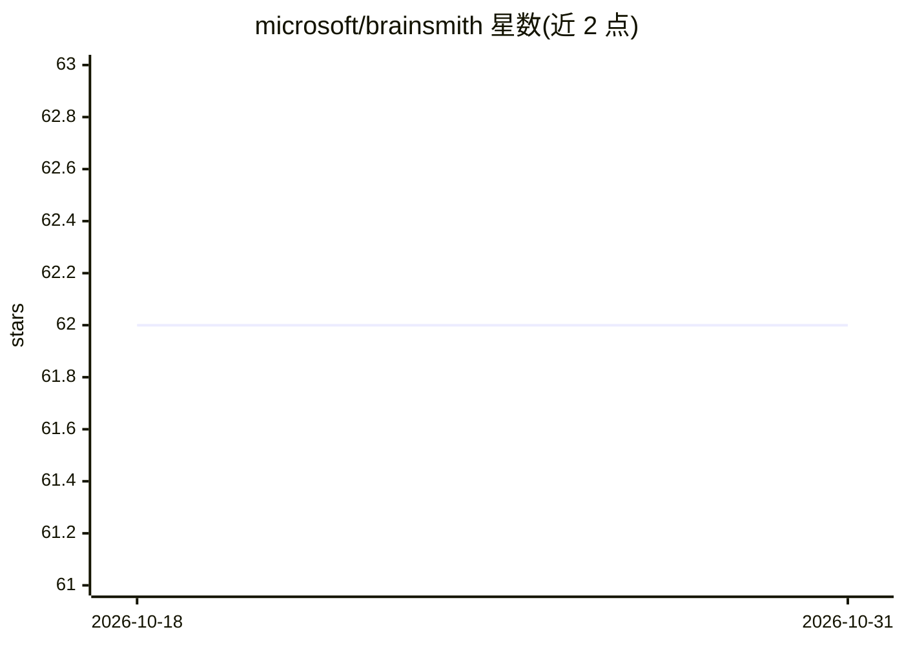

# microsoft/brainsmith

⭐ 62 · Python · NOASSERTION · 推送 2026-10-09 · [GitHub](https://github.com/microsoft/brainsmith) · [官网](https://microsoft.github.io/brainsmith/) · 组织维护

**微软开源工具：把 ONNX 模型自动转为 FPGA 数据流加速器 RTL**

Brainsmith 是微软开源的 AI 加速编译工具链：读取 ONNX 神经网络，通过自动化设计空间探索生成面向 FPGA 的优化数据流加速器，输出 RTL。机制包括 YAML Blueprint 定义设计空间（支持继承）、Schema 驱动的硬件核描述与自动校验、可插拔组件注册表扩展自定义核。面向 FPGA/硬件加速开发者，主开发平台为 Ubuntu 22.04+，需要 Python 3.11+ 与 Poetry，Vivado 2024.2 为 RTL 综合的可选依赖，另提供 Docker 安装途径。限制：单个 BERT 层的 quicktest 需 30-60 分钟。

## 筛选速览

| 维度 | 判定 | 备注 |
|---|---|---|
| AI 角色 | `ai-ecosystem` | LLM/agent 周边工具 |
| 许可风险 | `permissive` | NOASSERTION |
| 部署形态 | `None` |  |
| 模型依赖 | — | README 未给出锁定关系 |
| 硬件要求 | — | 无带数字的原话,不猜 |
| 安装摩擦 | `low` | 无编译、无系统依赖或容器化 |
| 成熟度 | — | 结构信号不足 |

## 能力要点

- ONNX 到 FPGA RTL 的自动转换
- 自动化设计空间探索（DSE）
- YAML Blueprint 定义设计空间，支持继承
- 插件式组件注册表，可扩展自定义 kernel 与流水线步骤

## 适用场景

- 把 ONNX 模型编译为 FPGA 硬件加速器
- 通过 Blueprint 定义并搜索时钟频率等硬件配置
- 为自定义算子开发可插拔硬件 kernel

## 场景标签

`推理引擎` · 领域:训练与推理

## 证据(README 行号)

> L6: Brainsmith transforms ONNX neural networks into optimized dataflow accelerators for FPGAs through automated design s
> L21: - **Ubuntu 22.04+** (primary development platform)

## 星数曲线

2026-10-18 62 → 2026-10-31 62（+0）

---
*卡片 v1 · prompt 1.4 · 生成 2026-10-24 · 置信度 high · 依据 README sha `393183bf45a8` · [字段定义](../../DATASET.md)*
