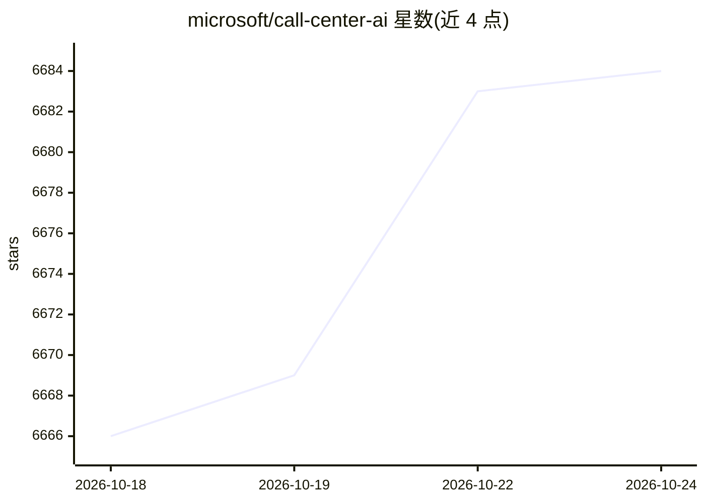

# microsoft/call-center-ai

⭐ 6,684 · Python · Apache-2.0 · 推送 2026-07-01 · [GitHub](https://github.com/microsoft/call-center-ai) · 组织维护

**微软的 AI 电话客服方案：Azure 语音加 GPT 处理呼入呼出电话**

部署在 Azure 上的容器化、serverless 电话客服解决方案：通过 Azure Communication Services 接入专用电话号码支持呼入与呼出，对话使用 gpt-4.1 与 gpt-4.1-nano，按结构化 claim 模式收集客户数据、生成待办清单，并按 RAG 方式从 AI Search 检索内部文档。支持多语言、自定义语音、内容审核与人工坐席回退，通话可录音并存储。提供预构建容器镜像经 make 部署到 Azure，也可本地运行；本地开发需 Rust、uv 与 Azure CLI 等工具。README 声明本项目为概念验证，不适用于生产环境。

## 筛选速览

| 维度 | 判定 | 备注 |
|---|---|---|
| AI 角色 | `ai-native` | 本体是模型或模型工具 |
| 许可风险 | `permissive` | Apache-2.0 |
| 部署形态 | `None` |  |
| 模型依赖 | locked-api |  |
| 硬件要求 | — | 无带数字的原话,不猜 |
| 安装摩擦 | `medium` | 含编译或系统依赖之一 |
| 成熟度 | `idea` | |

## 能力要点

- API 调用即可发起 AI 外呼，或由配置号码接听呼入
- 结构化 claim 模式收集数据并生成待办清单，模式可按通话自定义
- 基于 AI Search 的 RAG 检索私有文档，Redis 缓存提升效率
- 支持多语言、自定义神经语音、内容安全分级与人工坐席回退

## 适用场景

- 保险公司通过电话收集客户理赔信息
- IT 支持与客服场景搭建 24/7 自动接线 bot
- 在 Azure 上快速原型化 AI 电话客服方案

## 场景标签

`语音 Agent` `RAG` · 领域:对话与助手

## 证据(README 行号)

> L12: Send a phone call from AI agent, in an API call. Or, directly call the bot from the configured phone number!
> L83: > This project is a proof of concept. It is not intended to be used in production. This demonstrates how can be com

## 星数曲线

2026-10-18 6,666 → 2026-10-24 6,684（+18）

---
*卡片 v1 · prompt 1.4 · 生成 2026-10-20 · 置信度 high · 依据 README sha `ae2d2e2fedd6` · [字段定义](../../DATASET.md)*
