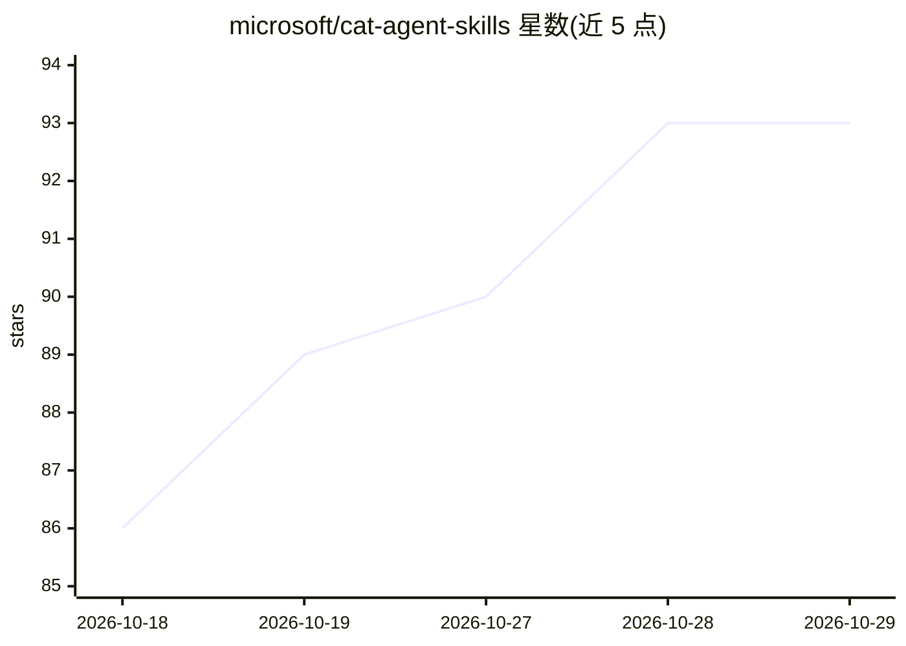

# microsoft/cat-agent-skills

⭐ 93 · Python · MIT · 推送 2026-10-27 · [GitHub](https://github.com/microsoft/cat-agent-skills) · 组织维护

**微软维护的 agent 技能社区画廊站点：供 Copilot Studio/Cowork/Scout 使用**

托管于 GitHub Pages 的静态画廊站点，聚合社区提交的 agent 技能（SKILL.md 指令集及可选脚本包）、Cowork 插件（M365 .zip 包）与 Scout 自动化（.json 导出），面向 Cowork、Copilot Studio 与 Scout 三类平台。站点用 Astro + Tailwind 构建，提供平台过滤、多条件筛选、客户端搜索、可分享 URL、排序与基于 GitHub Discussions 的点赞评分；每个技能有详情页与原样下载。技能通过 submissions/ 目录提交 PR，CI 校验元数据并生成页面。站点本身自述为示例实现，技能按原样提供。

## 筛选速览

| 维度 | 判定 | 备注 |
|---|---|---|
| AI 角色 | `ai-knowledge` | 知识聚合/清单类 |
| 许可风险 | `permissive` | MIT |
| 部署形态 | `desktop` | 安装包/桌面程序 |
| 模型依赖 | — | README 未给出锁定关系 |
| 硬件要求 | — | 无带数字的原话,不猜 |
| 安装摩擦 | `low` | 无编译、无系统依赖或容器化 |
| 成熟度 | — | 结构信号不足 |

## 能力要点

- 聚合技能、Cowork 插件、Scout 自动化三类提交，每类有独立格式标签与筛选
- 平台过滤、多条件 AND 筛选、客户端搜索与可分享过滤 URL
- 基于 GitHub Discussions 的点赞评分与 Top rated 排序
- 通过 submissions/ 目录 PR 提交，CI 校验并自动生成页面与下载包

## 适用场景

- 为我的 Copilot Studio 或 Cowork agent 查找可下载的技能
- 提交自己编写的 agent 技能并获取详情页与评分
- 通过 GitHub 链接在 Copilot Studio 中直接添加技能

## 场景标签

`精选清单` · 领域:学习与行业

## 证据(README 行号)

> L3: A community gallery of **skills for AI agents** — reusable instruction sets (and
> L4: optional script bundles) you can drop into **Cowork**, **Copilot Studio**, and
> L69: - **More than skills**: also hosts **Cowork plugins** (M365 `.zip` packages) and

## 星数曲线

2026-10-18 86 → 2026-10-29 93（+7）

---
*卡片 v1 · prompt 1.4 · 生成 2026-10-23 · 置信度 high · 依据 README sha `49490974c4cd` · [字段定义](../../DATASET.md)*
