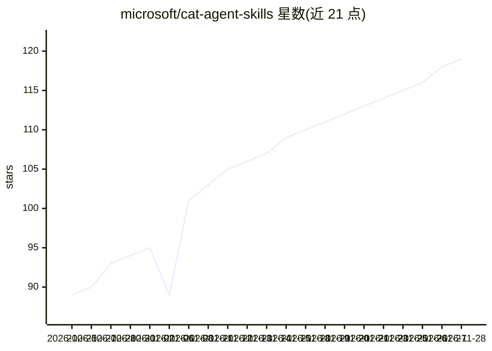

# microsoft/cat-agent-skills

⭐ 119 · Python · MIT · 推送 2026-11-24 · [GitHub](https://github.com/microsoft/cat-agent-skills) · 组织维护

**面向 Copilot Studio/Cowork/Scout 智能体的技能社区画廊站点**

微软维护的 AI 智能体技能（可复用指令集与可选脚本包）社区画廊，静态站点形式部署于 GitHub Pages，收录面向 Cowork、Copilot Studio、Scout 三个平台的 SKILL.md 技能、Cowork 插件与 Scout 自动化。站点用 Astro + Tailwind 构建，提供无限滚动浏览、客户端搜索、产品/类别/格式多选过滤、URL 可分享过滤、排序与评分（GitHub Discussions 点赞）。贡献者通过 submissions/ 目录提交并经 CI 校验生成页面；站点本身声明为示例实现，依赖底层 Microsoft 产品获得官方支持。

## 筛选速览

| 维度 | 判定 | 备注 |
|---|---|---|
| AI 角色 | `ai-knowledge` | 知识聚合/清单类 |
| 许可风险 | `permissive` | MIT |
| 部署形态 | `desktop` | 安装包/桌面程序 |
| 模型依赖 | — | README 未给出锁定关系 |
| 硬件要求 | — | 无带数字的原话,不猜 |
| 安装摩擦 | `low` | 无编译、无系统依赖或容器化 |
| 成熟度 | — | 结构信号不足 |

## 能力要点

- 技能、Cowork 插件、Scout 自动化三种格式的统一画廊与下载
- 产品/类别/格式多选过滤与 URL 参数可分享过滤
- submissions/ 目录 + CI 校验的社区贡献流程
- Copilot Studio 可经专用分支直接从 GitHub 添加技能

## 适用场景

- 为 Copilot Studio/Cowork/Scout 智能体查找可安装的技能
- 浏览按行业与职能分类的智能体技能目录
- 向社区提交自己编写的 SKILL.md 技能

## 场景标签

`精选清单` · 领域:学习与行业

## 证据(README 行号)

> L3: A community gallery of **skills for AI agents** — reusable instruction sets (and
> L4: optional script bundles) you can drop into **Cowork**, **Copilot Studio**, and
> L218: CAT Agent Skills is an **example implementation**. The underlying Microsoft

## 星数曲线

2026-10-25 89 → 2026-11-28 119（+30）

---
*卡片 v1 · prompt 1.4 · 生成 2026-11-28 · 置信度 high · 依据 README sha `46b0de314e0b` · [字段定义](../../DATASET.md)*
