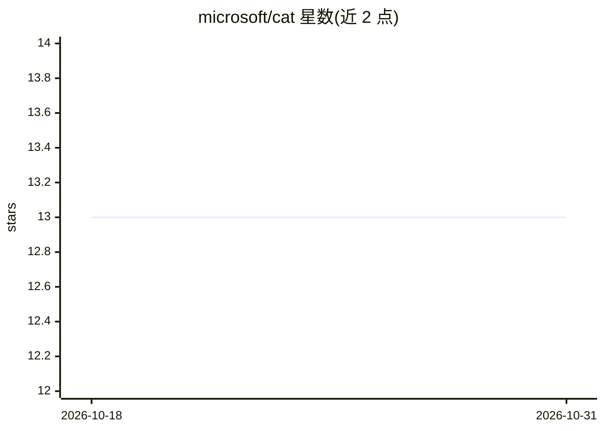

# microsoft/cat

⭐ 13 · HTML · MIT · 推送 2026-10-26 · [GitHub](https://github.com/microsoft/cat) · 组织维护

**微软 Copilot 采纳指南与研讨会资源的静态网站**

微软 Copilot Studio 工程团队下属 Copilot Acceleration Team 的网站源码仓库：发布 Microsoft 365 Copilot 与 Copilot Studio 的采纳指南、研讨会、工具与可下载资源（如 PPCC 会议页、AI 网络研讨会日程、Agent Excellence 工作坊、Copilot Summit 等）。网站为静态 GitHub Pages 站点，无构建步骤、包管理器或应用服务器，HTML/CSS/JavaScript 直接从仓库提供，本地预览仅需 git clone 后用任意静态 HTTP 服务器运行。

## 筛选速览

| 维度 | 判定 | 备注 |
|---|---|---|
| AI 角色 | `ai-knowledge` | 知识聚合/清单类 |
| 许可风险 | `permissive` | MIT |
| 部署形态 | `None` |  |
| 模型依赖 | — | README 未给出锁定关系 |
| 硬件要求 | — | 无带数字的原话,不猜 |
| 安装摩擦 | `low` | 无编译、无系统依赖或容器化 |
| 成熟度 | — | 结构信号不足 |

## 能力要点

- 静态 GitHub Pages 站点，无构建步骤与应用服务器
- 涵盖采纳指南、研讨会、工具与可下载 PDF 资源
- AI 网络研讨会日程以 YAML 数据驱动（programs/ai-webinar-sessions.yml）
- 使用 Fluent UI Web Components 与自定义设计系统，支持明暗主题

## 适用场景

- 查找 Microsoft 365 Copilot / Copilot Studio 的采纳与培训资源
- 参加 AI 网络研讨会、黑客松与工作坊等计划
- 获取 PPCC 会议与 Copilot Summit 的会议资料

## 场景标签

`教程课程` · 领域:学习与行业

## 证据(README 行号)

> L3: The Copilot Acceleration Team (CAT) is part of the Microsoft Copilot Studio engineering team. Our mission is to acce
> L5: This repository contains the source for the CAT website, including adoption guidance, workshops, tools, programs, an
> L9: CAT is a static GitHub Pages site. There is no build step, package manager, or application server: HTML, CSS, JavaSc

## 星数曲线

2026-10-18 13 → 2026-10-31 13（+0）

---
*卡片 v1 · prompt 1.4 · 生成 2026-10-31 · 置信度 high · 依据 README sha `098ec5548d82` · [字段定义](../../DATASET.md)*
