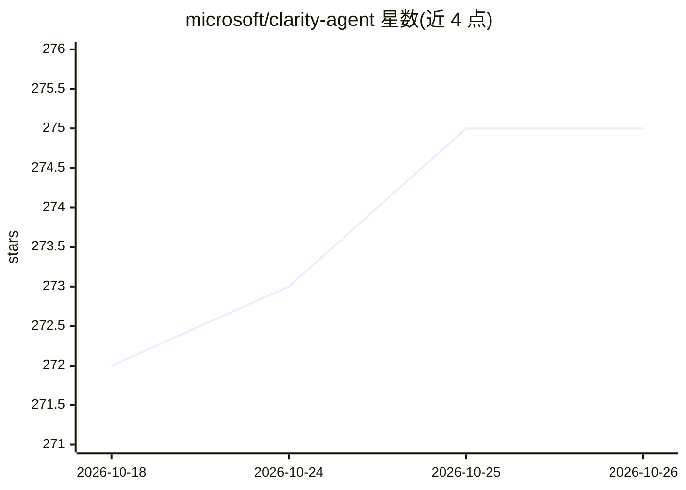

# microsoft/clarity-agent

⭐ 275 · Python · MIT · 推送 2026-10-23 · [GitHub](https://github.com/microsoft/clarity-agent) · 组织维护

**微软出品的 AI 思考伙伴：通过追问澄清意图并沉淀决策文档**

面向项目早期规划的 AI 对话工具：以结构化对话引导用户澄清问题、探索方案、分析失败模式并记录决策，结果写入仓库中的 .clarity-protocol/ 目录，以人类可读 markdown 管理，可提交、PR 审阅并导出 Markdown/Word 评审包。支持桌面应用、Web UI 与 CLI，接入 Anthropic/OpenAI/Azure AI/GitHub Copilot/Gemini 五类 LLM 供应商；可嵌入 git 仓库供编码 agent 沿用流程。明确声明 AI 内容可能不完整，不能替代健康/金融/法律等专业判断。

## 筛选速览

| 维度 | 判定 | 备注 |
|---|---|---|
| AI 角色 | `ai-native` | 本体是模型或模型工具 |
| 许可风险 | `permissive` | MIT |
| 部署形态 | `desktop` | 安装包/桌面程序 |
| 模型依赖 | locked-api |  |
| 硬件要求 | — | 无带数字的原话,不猜 |
| 安装摩擦 | `low` | 无编译、无系统依赖或容器化 |
| 成熟度 | — | 结构信号不足 |

## 能力要点

- 结构化对话产出问题澄清、方案探索、失败分析与决策跟踪四类文档
- 多角度独立思考者架构分析系统失败模式后综合结果
- 文档依赖图与过期追踪：上游变更时提示需重审的决策
- .clarity-protocol/ 以纯 markdown 存于仓库，可版本控制并嵌入 Claude Code/Cursor 等编码 agent

## 适用场景

- 动手写代码前先厘清问题与方案再开工
- 让编码 agent 沿用 .clarity-protocol/ 中的流程与上下文
- 生成评审包给干系人查看项目决策脉络
- 对现有代码库补齐问题陈述并保持文档不过期

## 场景标签

`AI 助手` · 领域:对话与助手

## 证据(README 行号)

> L3: An AI thinking partner that pushes back.
> L63: On first launch, the setup wizard walks you through connecting an LLM provider.

## 星数曲线

2026-10-18 272 → 2026-10-26 275（+3）

---
*卡片 v1 · prompt 1.4 · 生成 2026-10-22 · 置信度 high · 依据 README sha `99e088acd3a7` · [字段定义](../../DATASET.md)*
