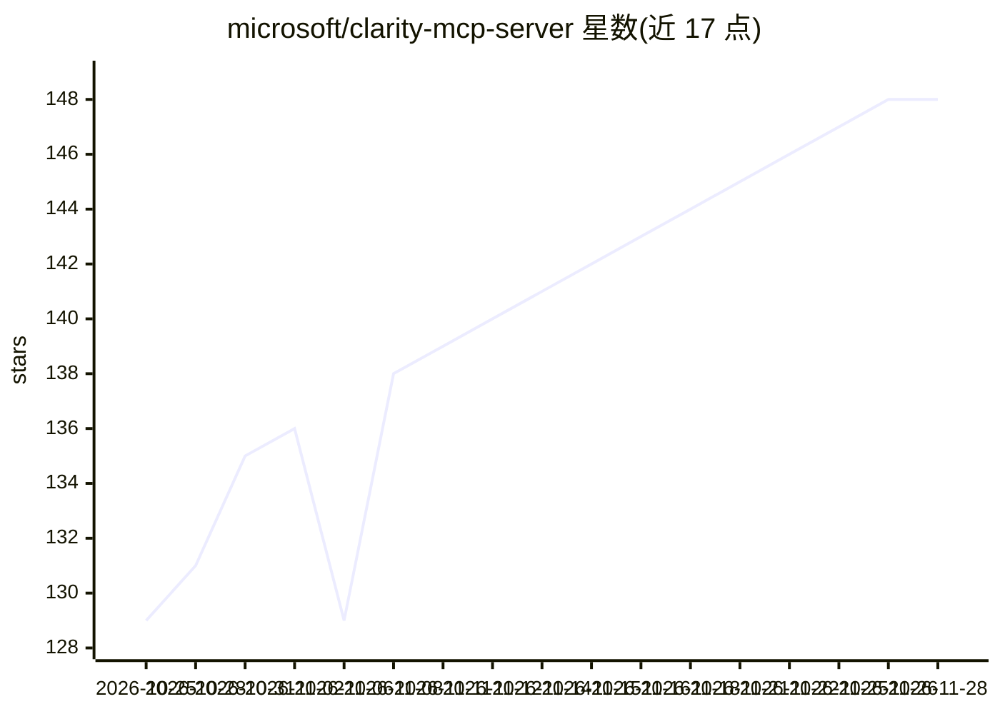

# microsoft/clarity-mcp-server

⭐ 148 · TypeScript · MIT · 推送 2026-11-17 · [GitHub](https://github.com/microsoft/clarity-mcp-server) · [官网](https://clarity.microsoft.com) · 组织维护

**让 MCP 客户端用自然语言查询 Microsoft Clarity 分析数据的服务器**

微软官方提供的 Model Context Protocol 服务器，将 Microsoft Clarity 接入 VS Code、Claude Desktop 等 MCP 兼容客户端。暴露分析仪表板查询、会话录制检索、AI Visibility 引用/爬虫/主题洞察、文档检索等工具，通过 OAuth 浏览器登录授权，支持按浏览器/设备/国家等维度过滤数据。需要 Node.js v16+ 和具备项目权限的 Clarity 账户；Data Export API token 认证方式已被声明弃用，需迁移到 OAuth。

## 筛选速览

| 维度 | 判定 | 备注 |
|---|---|---|
| AI 角色 | `ai-ecosystem` | LLM/agent 周边工具 |
| 许可风险 | `permissive` | MIT |
| 部署形态 | `library` | 以包/库形式分发 |
| 模型依赖 | — | README 未给出锁定关系 |
| 硬件要求 | — | 无带数字的原话,不猜 |
| 安装摩擦 | `low` | 无编译、无系统依赖或容器化 |
| 成熟度 | — | 结构信号不足 |

## 能力要点

- 暴露分析数据、会话录制、AI Visibility、文档检索等 MCP 工具
- 自然语言查询，支持按浏览器/设备/国家等维度过滤
- OAuth 浏览器登录授权，无需预配置 token
- 提供 npx/npm 全局安装及 VS Code 扩展、Claude Desktop 插件安装方式

## 适用场景

- 在 MCP 客户端中用自然语言查询 Clarity 流量与会话数据
- 分析 AI 爬虫对站点的抓取活动与引用情况
- 在工作流中直接检索 Clarity 使用文档

## 场景标签

`数据分析` · 领域:效率与自动化

## 证据(README 行号)

> L3: This Model Context Protocol (MCP) server connects Microsoft Clarity to Visual Studio Code, Claude Desktop, and other
> L131: The server exposes various tools that you can call from any MCP client.

## 星数曲线

2026-10-25 129 → 2026-11-28 148（+19）

---
*卡片 v1 · prompt 1.4 · 生成 2026-11-27 · 置信度 high · 依据 README sha `f9517c4f4b63` · [字段定义](../../DATASET.md)*
