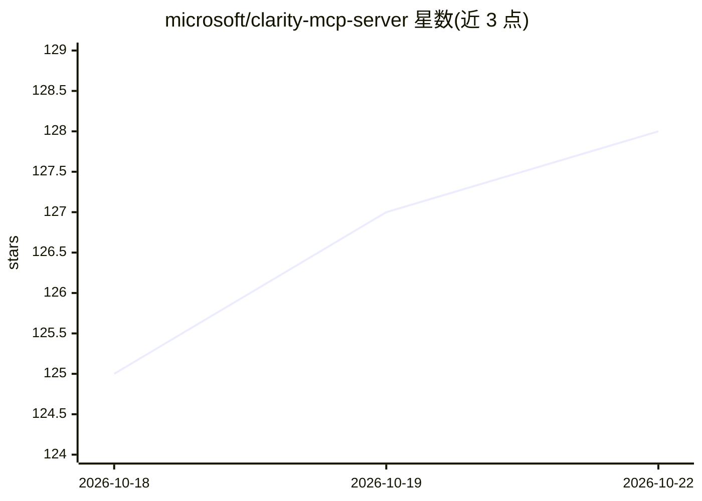

# microsoft/clarity-mcp-server

⭐ 129 · TypeScript · MIT · 推送 2026-02-24 · [GitHub](https://github.com/microsoft/clarity-mcp-server) · [官网](https://clarity.microsoft.com) · 组织维护

**连接 Microsoft Clarity 的 MCP 服务器：让 AI 客户端查询网站分析数据**

微软官方的 Model Context Protocol 服务器，将 Microsoft Clarity 的网站分析能力接入 Claude for Desktop、VS Code 等 MCP 兼容客户端。暴露三个工具：query-analytics-dashboard 以自然语言查询流量与用户行为指标、list-session-recordings 按浏览器/设备/国家等条件筛选会话录像、query-documentation-resources 检索 Clarity 官方文档。需要 Node.js v16+ 与 Clarity API token，通过 npm 全局安装或 npx 直接运行，另提供 VS Code 扩展与 Claude Desktop 插件两种安装途径。

## 筛选速览

| 维度 | 判定 | 备注 |
|---|---|---|
| AI 角色 | `ai-ecosystem` | LLM/agent 周边工具 |
| 许可风险 | `permissive` | MIT |
| 部署形态 | `library` | 以包/库形式分发 |
| 模型依赖 | — | README 未给出锁定关系 |
| 硬件要求 | — | 无带数字的原话,不猜 |
| 安装摩擦 | `low` | 无编译、无系统依赖或容器化 |
| 成熟度 | — | 结构信号不足 |

## 能力要点

- 自然语言查询 Clarity 分析仪表盘数据
- 按 URL/设备/浏览器/国家等多维度筛选会话录像
- 在客户端内检索 Microsoft Clarity 文档
- 提供 npm/npx、VS Code 扩展、Claude Desktop 插件三种安装方式

## 适用场景

- 在 AI 客户端里直接询问 Clarity 项目的流量与用户行为数据
- 用自然语言筛选并查看用户会话录像
- 在开发流程中查询 Clarity 文档解决配置问题

## 场景标签

`数据分析` · 领域:效率与自动化

## 证据(README 行号)

> L3: This is a Model Context Protocol (MCP) server for the Microsoft Clarity.
> L4: It allows you to access your session recordings, project analytics, and documentation from Clarity using Claude for 

## 星数曲线

2026-10-18 125 → 2026-10-22 128（+3）

---
*卡片 v1 · prompt 1.4 · 生成 2026-10-22 · 置信度 high · 依据 README sha `b0814c93ca47` · [字段定义](../../DATASET.md)*
