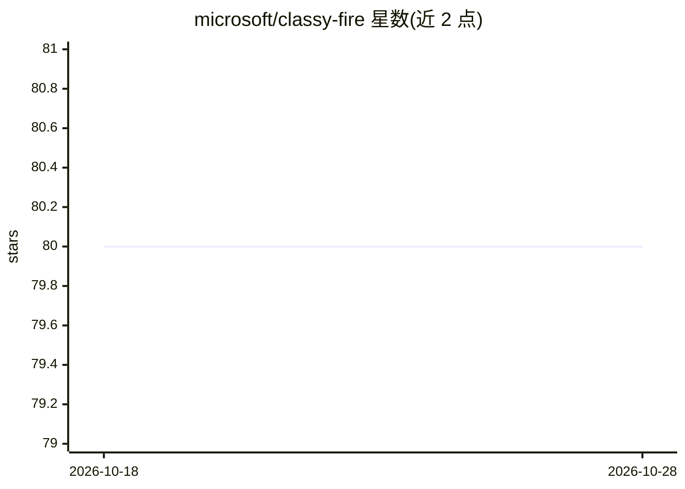

# microsoft/classy-fire

⭐ 80 · Jupyter Notebook · NOASSERTION · 推送 2026-09-14 · [GitHub](https://github.com/microsoft/classy-fire) · 组织维护

**调用 OpenAI/Azure LLM API 做多类文本分类的 Python 库**

微软开源的预训练多类文本分类库：将类别字符串映射到单 token 并施加先验概率，指示模型以单 token 响应以优化推理时长；通过 temperature=0 保证确定性输出，降低幻觉敏感度。另提供 MCMCClassifier，用 n 参数生成多路输出并以 MCMC 方法估计类别后验分布。支持任务描述与 few-shot 示例参数。前置要求为配置 Azure OpenAI 环境变量与 gpt-3.5-turbo 部署；评测仅在 100 条推文样本上进行，README 明确鼓励社区在更大规模数据集上复测。

## 筛选速览

| 维度 | 判定 | 备注 |
|---|---|---|
| AI 角色 | `ai-native` | 本体是模型或模型工具 |
| 许可风险 | `none` | NOASSERTION |
| 部署形态 | `library` | 以包/库形式分发 |
| 模型依赖 | locked-api |  |
| 硬件要求 | — | 无带数字的原话,不猜 |
| 安装摩擦 | `medium` | 含编译或系统依赖之一 |
| 成熟度 | — | 结构信号不足 |

## 能力要点

- 类别字符串映射单 token + 先验概率，单 token 生成优化推理
- temperature=0 保证确定性输出、降低幻觉敏感
- MCMCClassifier 以 MCMC 估计类别后验分布
- 支持 task_description 与 few_shot_examples 参数

## 适用场景

- 缺少训练数据时快速搭建文本分类器
- 对话流程中把用户输入稳定映射到预定动作/选项
- 需要确定性、可复现分类输出的应用

## 场景标签

 · 领域:NLP/文本分类

## 证据(README 行号)

> L2: Classy-fire is a pretrained multiclass text classification approach that leverages Azure OpenAI's LLM APIs using cle
> L23: classifier = LLMClassifier(["Banana", "Watermelon", "Apple", "Grape"])
> L59: * Classy-fire's LLMClassifier does this deterministically and with less sensitivity to confabulation (hallucination

## 星数曲线

2026-10-18 80 → 2026-10-28 80（+0）

---
*卡片 v1 · prompt 1.4 · 生成 2026-10-24 · 置信度 high · 依据 README sha `f40fb5c01869` · [字段定义](../../DATASET.md)*
