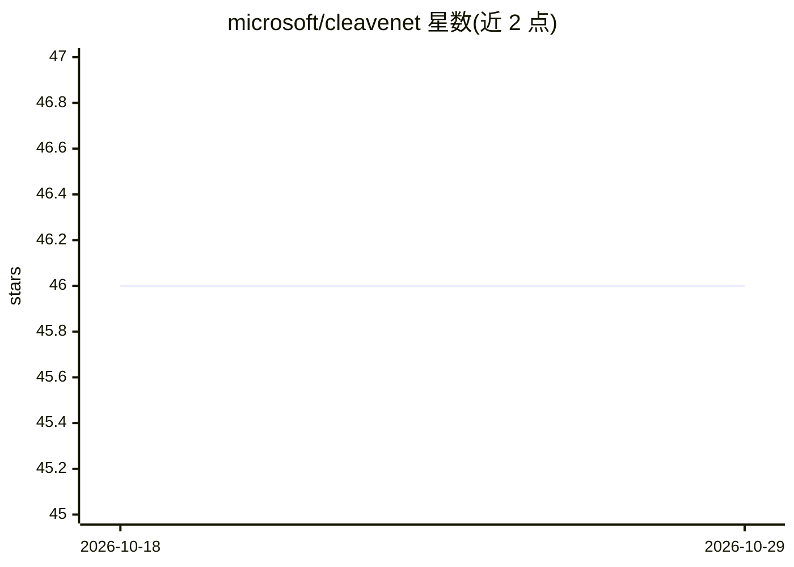

# microsoft/cleavenet

⭐ 46 · Python · MIT · 推送 2026-07-24 · [GitHub](https://github.com/microsoft/cleavenet) · 组织维护

**蛋白酶底物肽段的深度学习预测与生成工具**

微软发布的端到端 AI 流水线，面向蛋白酶底物设计：包含 CleaveNet Predictor（预测 17 种 MMP 对肽段的切割，支持 Transformer 与 LSTM 两种骨干网络）与 CleaveNet Generator（自回归模型，可无条件生成或按目标切割谱条件化生成肽段底物）。输入为 CSV 肽段序列，长度限 10 个残基以内，短序列需用 '-' 填充。提供 Jupyter notebook 快速上手，训练与推断可用 CPU 运行，GPU 可加速。研究成果经过体外大规模筛选验证，作者要求引用其预印本。

## 筛选速览

| 维度 | 判定 | 备注 |
|---|---|---|
| AI 角色 | `ai-native` | 本体是模型或模型工具 |
| 许可风险 | `permissive` | MIT |
| 部署形态 | `library` | 以包/库形式分发 |
| 模型依赖 | — | README 未给出锁定关系 |
| 硬件要求 | — | 无带数字的原话,不猜 |
| 安装摩擦 | `low` | 无编译、无系统依赖或容器化 |
| 成熟度 | — | 结构信号不足 |

## 能力要点

- 预测 17 种 MMP（MMP1–MMP25）对肽段序列的切割行为
- 自回归生成器支持无条件生成与按目标 z-score 切割谱的条件化生成
- Transformer 为默认骨干，可选 LSTM 架构
- 提供训练、预测、生成完整脚本与 Jupyter notebook 入门

## 适用场景

- 预测候选肽段被各 MMP 切割的活性
- 按目标切割谱定向生成高效、高选择性的底物肽段
- 基于自有数据重新训练预测器或生成器

## 场景标签

 · 领域:计算生物学/蛋白质工程

## 证据(README 行号)

> L4: CleaveNet is an end-to-end AI pipeline for the design of protease substrates. Applied to matrix metalloproteinases,
> L5: CleaveNet enhances the scale, tunability, and efficiency of substrate design. CleaveNet generates peptide substrates
> L69: You can use `src/predict.py` to predict cleavage of peptide sequences by our evaluated MMPs: MMP1, MMP2, MMP3, MMP7

## 星数曲线

2026-10-18 46 → 2026-10-29 46（+0）

---
*卡片 v1 · prompt 1.4 · 生成 2026-10-25 · 置信度 high · 依据 README sha `1277bb392180` · [字段定义](../../DATASET.md)*
