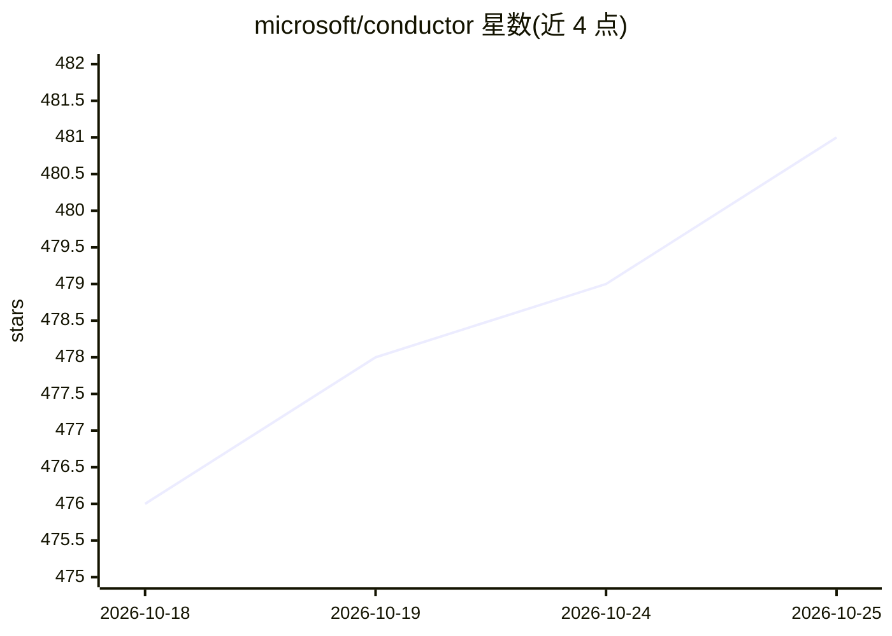

# microsoft/conductor

⭐ 482 · Python · MIT · 推送 2026-10-23 · [GitHub](https://github.com/microsoft/conductor) · 组织维护

**用 YAML 定义并确定性运行多 agent 工作流的 CLI**

微软开源的命令行工具：在单个 YAML 文件中定义多个 agent、提示词与路由条件，然后运行代码评审流水线、先研究后综合、先规划后实现等多 agent 工作流。编排层不使用 LLM——路由靠 Jinja2 模板与表达式求值（首个匹配条件生效），不消耗 token 决定下一步。支持 GitHub Copilot、Anthropic Claude 等多个提供方，支持并行执行、子工作流组合、MCP 工具直接调用、人机协同暂停、Web 仪表盘与 TUI Fleet Manager。面向构建可版本化、可复现 agent 工作流的开发者。

## 筛选速览

| 维度 | 判定 | 备注 |
|---|---|---|
| AI 角色 | `ai-ecosystem` | LLM/agent 周边工具 |
| 许可风险 | `permissive` | MIT |
| 部署形态 | `library` | 以包/库形式分发 |
| 模型依赖 | local-ok | 支持本地模型 |
| 硬件要求 | — | 无带数字的原话,不猜 |
| 安装摩擦 | `low` | 无编译、无系统依赖或容器化 |
| 成熟度 | `idea` | |

## 能力要点

- YAML 定义多 agent 工作流，编排循环中无 LLM，路由确定性
- 多提供方支持：GitHub Copilot、Anthropic Claude、Claude Agent SDK、NousResearch Hermes（实验性）
- 并行执行、for-each 动态分组与子工作流组合
- MCP 工具直接调用（无 LLM、零 prompt token）、Web 仪表盘与 Fleet Manager TUI

## 适用场景

- 把代码评审、研究-综合、规划-实现等多 agent 流程固化为可版本控制的 YAML
- 在 CI 与本地以相同方式运行同一工作流
- 通过 Web 仪表盘实时观测 DAG 执行并处理人机协同节点

## 场景标签

`Agent 框架` `多智能体` · 领域:Agent 开发

## 证据(README 行号)

> L3: A CLI tool for defining and running multi-agent workflows with the GitHub Copilot SDK and Anthropic Claude.
> L10: Conductor makes multi-agent workflows — code review pipelines, research-then-synthesize flows, plan-then-implement 
> L19: - **Multiple providers** - GitHub Copilot, Anthropic Claude, Claude Agent SDK (experimental), NousResearch Hermes (

## 星数曲线

2026-10-18 476 → 2026-10-25 481（+5）

---
*卡片 v1 · prompt 1.4 · 生成 2026-10-21 · 置信度 mid · 依据 README sha `f3eee01a1a9a` · [字段定义](../../DATASET.md)*
