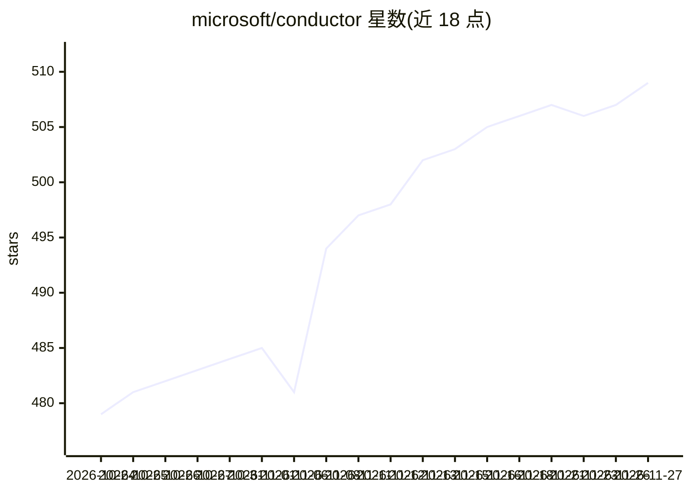

# microsoft/conductor

⭐ 509 · Python · MIT · 推送 2026-11-25 · [GitHub](https://github.com/microsoft/conductor) · 组织维护

**开发者用 YAML 定义并运行多智能体工作流的 CLI 编排工具**

微软出品的 Python CLI 工具，用单个 YAML 文件定义多智能体工作流（代码评审流水线、研究-综合流程、计划-实施循环等），通过 GitHub Copilot SDK、Anthropic Claude、Claude Agent SDK 等多后端驱动各 agent。路由基于 Jinja2 模板与表达式求值，编排环内不含 LLM，同一输入走相同路径；支持并行执行、子工作流组合、脚本与 MCP 步骤、条件路由、人在回路、迭代/超时限制，并提供实时 Web 仪表盘、Fleet Manager TUI 与 OpenTelemetry 追踪。要求 Python 3.12+。

## 筛选速览

| 维度 | 判定 | 备注 |
|---|---|---|
| AI 角色 | `ai-ecosystem` | LLM/agent 周边工具 |
| 许可风险 | `permissive` | MIT |
| 部署形态 | `library` | 以包/库形式分发 |
| 模型依赖 | locked-api |  |
| 硬件要求 | — | 无带数字的原话,不猜 |
| 安装摩擦 | `low` | 无编译、无系统依赖或容器化 |
| 成熟度 | — | 结构信号不足 |

## 能力要点

- YAML 定义工作流，Jinja2 条件路由，编排决策不消耗 LLM token
- 多 provider 后端（GitHub Copilot、Anthropic Claude、Claude Agent SDK 等）可切换
- 并行执行、for_each 动态分组与可复用子工作流
- Web 仪表盘 DAG 可视化、OpenTelemetry 追踪导出

## 适用场景

- 把代码评审流水线固化为版本可控、可复现的 YAML 工作流
- 编排先研究后综合、先计划后实施的多 agent 流程
- 在本地与 CI 中以相同方式运行同一份工作流定义
- 通过 Web 仪表盘监控并行 agent 运行并在浏览器中处理人工审批

## 场景标签

`Agent 框架` `多智能体` · 领域:Agent 开发

## 证据(README 行号)

> L10: Conductor makes multi-agent workflows — code review pipelines, research-then-synthesize flows, plan-then-implement 
> L13: - **Deterministic** — Routing uses Jinja2 templates and expression evaluation. First matching condition wins. No LL
> L19: - **Multiple providers** - GitHub Copilot, Anthropic Claude, Claude Agent SDK (experimental), NousResearch Hermes (

## 星数曲线

2026-10-24 479 → 2026-11-27 509（+30）

---
*卡片 v1 · prompt 1.4 · 生成 2026-11-25 · 置信度 high · 依据 README sha `31a1e44c7c7a` · [字段定义](../../DATASET.md)*
